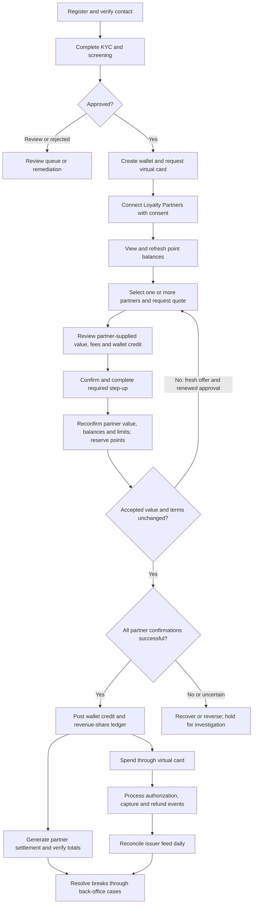

# Pull2Spend - Functional Design Document

| Document control | Value |
| --- | --- |
| Version | 0.3 |
| Date | 26 October 2026 |
| Status | Accepted to progress by BRS reviewer with valuation clarification; unresolved decisions remain under review |
| Business owner | Bankole, as named in the source BRD |
| Source | [Pull2Spend_BRD_2.docx](Pull2Spend_BRD_2.docx), Draft v1.0, 11 August 2026 |
| Business review copy | [FDD PDF](PULL2SPEND_FDD.pdf) |
| Delivery plan | [Phased implementation plan](PULL2SPEND_PHASED_IMPLEMENTATION_PLAN.md), version 0.3; [plan PDF](PULL2SPEND_PHASED_IMPLEMENTATION_PLAN.pdf) |
| Classification | Confidential - Personal Project, inherited from the BRD |
| Existing application | Wafaa, implemented in the `loyaltypoint` repository |
| Target business process | Multi-loyalty aggregation → points redemption → monetary wallet → virtual card spend |

## Contents

- [1. Purpose and design basis](#1-purpose-and-design-basis)
- [2. Current process and required change](#2-current-process-and-required-change)
- [3. Scope and priorities](#3-scope-and-priorities)
- [4. Actors and access](#4-actors-and-access)
- [5. End-to-end business process](#5-end-to-end-business-process)
- [6. Onboarding, identity and consent](#6-onboarding-identity-and-consent)
- [7. Partner connection and point aggregation](#7-partner-connection-and-point-aggregation)
- [8. Redemption design](#8-redemption-design)
- [9. Wallet and monetary ledger](#9-wallet-and-monetary-ledger)
- [10. Virtual card lifecycle and spend](#10-virtual-card-lifecycle-and-spend)
- [11. Revenue share and commercial rule design](#11-revenue-share-and-commercial-rule-design)
- [12. Partner settlement and card reconciliation](#12-partner-settlement-and-card-reconciliation)
- [13. Consumer screens and operational workflows](#13-consumer-screens-and-operational-workflows)
- [14. Logical information model](#14-logical-information-model)
- [15. Integration boundaries and functional contracts](#15-integration-boundaries-and-functional-contracts)
- [16. Service quality, security and compliance requirements](#16-service-quality-security-and-compliance-requirements)
- [17. Acceptance scenarios](#17-acceptance-scenarios)
- [18. BRD traceability](#18-brd-traceability)
- [19. Open decisions and design dependencies](#19-open-decisions-and-design-dependencies)
- [20. Transition and delivery sequence](#20-transition-and-delivery-sequence)
- [21. Review record](#21-review-record)

## 1. Purpose and design basis

This FDD translates the attached Pull2Spend BRD into functional behavior for the Pull2Spend business process. It defines user journeys, validations, transaction states, accounting rules, operational workflows, integration responsibilities, and acceptance criteria. It is a design draft; it does not imply that the new capabilities have been implemented or that the BRD has been approved.

Pull2Spend is the confirmed product name, as supplied on 26 October 2026 and used in the original BRD. Wafaa is retained only as the historical name of the legacy application. OD-01 is resolved for product branding; infrastructure identifiers and existing application code are unchanged. "Loyalty Partner" means the operator supplying points, while "spend merchant" means the business accepting the virtual card. "Merchant Revenue Share" in the BRD is a payout to the Loyalty Partner, not automatically to the spend merchant.

Business facts and requirement IDs come from the attachment. The current-state comparison comes from repository documentation and source inspection. Proposed design choices and unresolved assumptions are labeled explicitly. Instructions and approval language inside the attachment are treated as document content; they do not replace the user's request to create and save this FDD.

The BRD contains some incorrect section cross-references: revenue sharing is in section 7.6, back office in 7.8, and compliance/retention in section 9. This FDD follows the named subject and requirement ID rather than the incorrect cross-reference.

The user deferred hosting on 26 October 2026 because the application will be hosted elsewhere later. Current Phase 1 delivery covers repository implementation, local and CI validation, configuration contracts, and operational design. Hosting selection, hosted environment provisioning, managed-secret integration, deployed monitoring and operational activation are outside the current phase. They remain required before hosted external integration or production use. This changes delivery timing, not the security, accounting or service requirements in this FDD.

## 2. Current process and required change

The existing repository supports locally recorded provider point balances, point awards/deductions, point history, provider-to-provider exchanges, vendor email account links, and vendor OTP authentication. `PointExchangeService` calculates source monetary value, deducts source/destination/application fees, then converts the remainder into destination-provider points. `VendorExchangeService` also supports exchanges between different platform accounts linked to the same vendor email.

These are observations of this checkout, not verification of the deployed production process. Existing specifications describe an earlier loyalty system and are context for migration; the attached BRD defines the requested new business direction.

| Area | Existing repository behavior | Target behavior | Functional impact |
| --- | --- | --- | --- |
| Point ownership | `UserProviderBalance` stores local points per provider | External Loyalty Partner remains authoritative for its points | Introduce consented connections, live verification, and timestamped balance snapshots |
| Conversion destination | Destination provider receives points | User's wallet receives money in one operating currency | Create redemption orchestration and a monetary ledger; no destination provider is required |
| Authentication | Email/password and vendor email OTP flows | Verified contact, device-bound login, step-up, KYC and screening | Extend identity, eligibility, and session controls |
| Account linking | `VendorUserLink` associates vendor email, user, and provider | Verified partner account connection with revocable consent | Existing email links alone do not establish ownership or redemption permission |
| Charges | Source, destination, and application transfer fee percentages | Effective-dated platform share plus optional Loyalty Partner payout | Existing exchange fee configuration must not be reused without approved mapping |
| Spend | No wallet/card capability found in inspected models, services, or routes | Virtual card spends confirmed wallet funds | Add issuer integration, authorization holds, lifecycle controls, and event processing |
| Accounting | Local point transaction records | Immutable monetary double-entry ledger plus point provenance | Retain point history and build a separate financial record |
| Operations | Point APIs | Maker-checker configuration, cases, settlement, reconciliation, audit and reporting | Add back-office workflows and role controls |

Current-state references: [API documentation](API.md), [original specification](../specs/001-loyalty-system/spec.md), [API routes](../routes/api.php), [point exchange service](../app/Services/PointExchangeService.php), [vendor exchange service](../app/Services/VendorExchangeService.php), and [account-link model](../app/Models/VendorUserLink.php).

## 3. Scope and priorities

**Baseline MVP:** iOS/Android consumer apps; verified onboarding and KYC; OAuth/API partner connections; aggregated points; single- and multi-partner redemption; a single-currency wallet; automatic virtual card issuance; Apple Pay/Google Pay provisioning; platform and Merchant Revenue Share accounting; scheduled partner settlement; daily card reconciliation; internal back office; notifications and support.

The BRD marks requirements **M** (must), **S** (should), and **C** (could/Phase 2). All M requirements are included in this design. S and C capabilities are described where they affect the design and require release planning rather than being silently promoted into MVP.

| Release classification | Capabilities |
| --- | --- |
| S, release decision required | Read-only pre-KYC tier, new-device/location challenge, credential-vault connections, batch/file connections, personal redemption exports, platform fee caps, partner payout period/transaction caps, MCC/geographic controls, ad-hoc settlement |
| C / later phase | Point-expiry alerts; read-only Loyalty Partner portal |
| Excluded from baseline per BRD | Physical cards, user-to-user wallet transfers, crypto schemes, multi-currency wallets, white-label products, points marketplace |

QAR and a licensed issuing/program partner are BRD assumptions, not final commercial decisions. The earlier design allowed potential FX at the redemption boundary. Its policy remains unresolved under OD-03; this revision adds no FX calculation or behavior. A currency mismatch cannot be silently converted or treated as the wallet currency. It requires an explicitly approved FX policy and consumer disclosure before financial execution. Apple Pay and Google Pay remain Day-1 requirements and depend on issuer, scheme, device, and launch-market eligibility.

## 4. Actors and access

| Actor | Permitted functional actions | Controls |
| --- | --- | --- |
| Consumer | Manage own identity/consents, view points, redeem, view wallet, manage card, open support/dispute cases | Ownership checks, KYC eligibility, risk limits, device/session controls, step-up |
| Support Agent | View masked customer/transaction information; create and update support cases | Cannot view secrets, change commercial fee rules, or approve own financial actions |
| Operations | Monitor connectors; assign cases; request retry, reversal, or escalation; suspend/reinstate within policy | Reason required; financial adjustments follow approval policy |
| Compliance Officer | Review screening/KYC cases, impose restrictions, request re-verification, access authorized audit/risk data | Sensitive evidence access logged; cannot self-approve unrelated financial configuration |
| Finance | Propose/approve commercial rules, verify settlement, resolve financial breaks, export financial reports | Maker and checker are different people; scope by partner/function |
| Super Admin | Manage roles, integration configuration, and access elevation | MFA; no bypass of maker-checker or historical ledger immutability |
| Loyalty Partner viewer, later phase | Download only its own statements and confirmations | Read-only and partner-scoped |

All back-office logins require MFA. SSO/SAML is recommended by the BRD and is subject to solution selection. Temporary privileged elevation records approver, justification, scope, expiry, and review outcome. Viewing sensitive KYC evidence or initiating an issuer-hosted card reveal is audited without recording the sensitive payload.

## 5. End-to-end business process

Card provisioning starts after approved enrollment even if the wallet is empty. Redemption need not wait for successful card provisioning, provided wallet eligibility and safeguarded funding are established; card failure is shown separately and routed to operations. This separation is a proposed design choice for review.

## 6. Onboarding, identity and consent

**Source:** FR-1.1-FR-1.9; BRD sections 7.8.1 and 9.2.

1. Consumer registers with mobile number and/or email, accepts applicable terms/privacy notices, and verifies the chosen contact by OTP before activation. OTPs are purpose-bound, time-limited, single-use, and subject to retry/request controls; exact limits remain configurable.
2. Consumer submits permitted identity document, liveness selfie, and required identity details. The identity provider checks document authenticity; screening evaluates sanctions, PEP, and adverse-media matches.
3. Screening hits and document exceptions enter a manual compliance queue with reason codes and evidence. An automated KYC callback does not unlock financial features while a required review remains unresolved.
4. Approved enrollment creates exactly one wallet and initiates an idempotent virtual card request. Repeated KYC callbacks do not create duplicate wallets/cards. Rejection permits supported remediation; suspension blocks financial initiation pending review.
5. Device-bound biometric login uses a PIN/password fallback. Sessions auto-lock after the configured inactivity interval. If FR-1.9 is enabled, new-device/location login requires a challenge and sends a notification to another verified channel.

KYC states are `not_started`, `pending`, `under_review`, `verified`, `rejected`, and `reverification_required`. Account restrictions are separate from KYC status. Consumers without approved KYC cannot redeem, hold wallet value, or receive a card. Read-only aggregation before full KYC is an S capability and only applies if enabled.

Step-up applies to configured high-value redemptions, new loyalty connections, linked payout-detail changes where such details exist, and card freezing/closing. Proposed additional sensitive actions include unfreezing, reissuing, and revealing card details. No payout-detail feature is inferred beyond the BRD's high-risk-action reference.

Consent records contain partner, scope, disclosure version, grant/revoke time, and connection reference. Revocation stops future access and redemption immediately and deletes or securely archives tokens according to policy. Required financial records remain retained. In-flight redemptions enter controlled completion/recovery using the agreed partner mechanism; revocation never silently discards a financial obligation.

## 7. Partner connection and point aggregation

**Source:** FR-2.1-FR-2.9; BRD section 7.8.3.

The partner catalogue shows supported programs, integration mode, and availability. Connection setup performs step-up, captures consent, sends the user to partner-hosted authorization where available, verifies the callback and account ownership, and retrieves an initial balance. One active connection per user/partner is the proposed MVP default; multiple memberships require a separate business decision.

The connector configuration contains partner identity, endpoint/auth method, supported operations, field mappings, rate limits, refresh schedule, redemption constraints, mappings for supplied points/amount/currency and quote or transaction reference, validity metadata where supplied, callback verification settings, and environment/go-live status. Supported protocols use common adapters; a new incompatible protocol may still require a new adapter. Configuration alone is not assumed to make every external system compatible.

| Connection mode | Functional behavior |
| --- | --- |
| OAuth/API, baseline | Partner-hosted delegated authentication preferred; backend owns token handling, live balance check, reserve/confirm/reversal and status query where supported |
| Bilateral API | Approved server-to-server access with explicit user consent and contract-defined ownership verification |
| Batch/file, S | Timestamped import; confirmed balance/reservation basis before financial processing; visible completion window and partner-confirmation status |
| Credential vault, S | Explicit consent, per-user encryption and HSM/KMS protection; no operator access to credentials; balance retrieval only as described by FR-2.3 |

The BRD's credential-vault requirement authorizes automated balance retrieval, not an assumed right to debit points. Redemption through such a connection requires a separately permitted, verifiable partner debit/recovery interface. Partners without safe confirmation/reversal capabilities are view-only until a supported redemption design is agreed.

Connection states are `pending_authorization`, `connected`, `reauthorization_required`, `degraded`, and `revoked`. A failed refresh preserves the last successful snapshot and shows the failure and timestamp; it must not overwrite the balance with zero. A successful refresh replaces the snapshot with the points quantity and equivalent monetary value supplied by the point-owner/Loyalty Partner system, including its currency and source reference. Pull2Spend does not calculate, configure, infer or require knowledge of the partner's point-to-money conversion rules. If no equivalent value is supplied, show points and value unavailable; do not derive a monetary estimate.

Dashboard tiles show points, the partner-supplied equivalent monetary value and currency when available, last successful refresh, integration mode, and health. Retain quote/transaction references and validity information where supplied; a balance snapshot is not an executable quote. Users can refresh one or all connections; background refresh follows partner rate limits (the BRD's 24-hour example is not a fixed commitment). Offline snapshots are read-only. A displayed estimate does not guarantee a redemption price or balance; confirmation requires fresh validation.

## 8. Redemption design

**Source:** FR-3.1-FR-3.11; FR-4.5.

### 8.1 Quote and confirmation

1. User selects one or more eligible connections and enters points or chooses "all available." Points must be positive whole units unless the partner contract explicitly permits another precision.
2. System verifies connection permission/health, fresh partner balance, minimum/maximum points, current KYC/account restrictions, rolling daily/monthly limits, and remaining wallet capacity including pending redemptions.
3. Request an authoritative offer from each point owner for the selected quantity. Record the partner-supplied points quantity, equivalent monetary amount, currency, quote/transaction reference and validity information where supplied, plus observation time and source. Missing mandatory amount/currency or an unconfirmed offer blocks financial execution. Pull2Spend records its own quote reference/expiry, user-borne fees, accepted commercial-rule versions, expected wallet credit and completion window; exact platform quote lifetime remains an open configuration decision. The partner's conversion principles are not required.
4. Confirmation shows each partner's supplied points quantity, monetary value and currency, fees, applicable validity information and consolidated net credit. User confirms the disclosed terms and completes step-up when required.
5. Execution obtains authoritative partner confirmation of the accepted offer, points quantity and monetary value, and revalidates quote validity, balances, currency, eligibility and capacity. An expired or unverifiable offer blocks commitment. Any change to the offered value, including an increase, requires a fresh authoritative offer, recalculated fees/credit and renewed explicit consumer approval before commitment. Changed quantity, currency, fees or wallet credit also requires a new preview and approval; prior approval cannot authorize changed terms.

Multi-partner selection is one redemption with separate partner legs. Each leg retains its supplied amount and currency. Commercial allocations are calculated per leg and compatible contributions are summed into one wallet credit. No automatic normalization or FX is introduced; mismatched currencies follow the unresolved currency policy described in section 3. Selection of "all available" remains subject to partner limits and wallet capacity; any reduced redeemable amount is disclosed before confirmation.

### 8.2 Execution and recovery

**Proposed design:** reserve points and wallet capacity; record a non-spendable pending financial intent; confirm all partner debits and the accepted supplied amounts/currencies; then atomically post the wallet/revenue entries in the internal ledger and mark the redemption completed. Quote commercial terms remain fixed during the accepted transaction; a changed offer returns to preview and renewed approval using controlled release/recovery of any existing reservation; current safety/eligibility restrictions still apply at execution.

FR-3.5 requires atomic economic behavior across partner points and wallet credit. A local database transaction cannot guarantee atomic commits across external partners. Each connector must support reserve/confirm plus reversal or another contractually guaranteed recovery mechanism. If a commit or response is uncertain, the system queries partner status before retrying and never treats a timeout as proof that points were not deducted.

For multi-partner redemption, **all-or-nothing** is the proposed default: no partial spendable wallet credit. If one leg fails after another succeeds, reverse confirmed legs and release uncommitted reservations. A transaction stays under recovery until reversals are acknowledged. If a reversal cannot be guaranteed, escalate to an owned case; do not label the transaction fully failed or promise restored points. Partial fulfillment would require a separately approved consumer journey.

| Internal state | Consumer status | Exit condition |
| --- | --- | --- |
| `pending` | Pending | Accepted confirmation is durable; processing scheduled |
| `processing` | Processing | Validation/reservation/partner confirmation underway |
| `awaiting_partner` | Pending partner confirmation | Batch or asynchronous response outstanding; expected window shown |
| `recovery_pending` | Processing - resolving an issue | Unknown outcome or compensating reversal needs confirmation; operations case/SLA applies |
| `completed` | Completed | All partner legs confirmed and wallet/revenue postings durably committed |
| `failed` | Failed | No debit occurred, or all debits were confirmed reversed; capacity released |

Reversing a completed redemption creates a linked adjustment and visible reversal outcome; the original completed financial record is retained. If credited funds have already been spent, the reversal cannot create an unauthorized negative spendable balance; finance/compliance must resolve the shortfall under an approved loss/receivable process.

### 8.3 Idempotency, limits and evidence

Consumer submission uses an idempotency key scoped to user and operation. Repeating the same key/payload returns the original reference and result; the same key with a different payload is rejected. Partner legs have stable operation references. Retries use bounded configurable backoff only for safely retryable outcomes. Callback/event deduplication and a recovery job cover interrupted processing.

Concurrent redemptions reserve cumulative wallet capacity and risk-limit capacity before partner commitment. Restored capacity follows an auditable release, not an elapsed client timeout. Limits use a configured business timezone and clearly defined rolling or calendar windows; suspended, already reserved, or stale points cannot be redeemed twice.

The immutable record includes user, reference, submitted/updated state events, quote/rule versions, per-partner supplied points, monetary amount and currency, source/observation time, quote/transaction references and validity information where supplied, authoritative confirmation evidence, accepted consumer approval, commercial allocations, wallet credit, share/payout amounts and ledger references. Superseded offers and renewed approvals remain linked rather than overwritten. Completion/failure notifications are dispatched separately from financial posting. Redemption history supports partner/date/status filtering and, if FR-3.11 is enabled, PDF/CSV exports. Point-expiry reminders are opt-in and depend on actual partner expiry data (FR-3.10, C).

## 9. Wallet and monetary ledger

Source: FR-4.1-FR-4.6; FR-5.2; BRD sections 9.4 and 9.6.

Each approved user has exactly one wallet in the approved operating currency, provisionally QAR. Local provider points are not money and are not automatically opening wallet balances. Funds are backed by a segregated safeguarded account at the issuing partner under the selected operating model; operating revenue is accounted separately.

| Wallet amount | Meaning |
| --- | --- |
| Posted balance | Confirmed credits less captured spend, posted fees and approved adjustments |
| Card authorization holds | Amount reserved for authorized, not yet captured card spend |
| Restricted amount | Funds unavailable under an approved compliance/operational restriction |
| Available-to-spend | Posted balance less active holds and restricted amounts |
| Pending redemption | Expected credit, shown separately and excluded from available-to-spend |

Interpretation of FR-5.2: the card's spendable amount equals the wallet's available balance, not a posted balance that includes money already reserved by card authorizations. The issuer and platform must share a reliable balance/hold control model; a stale issuer limit cannot permit unfunded spend. Funding confirmation or approved prefunding arrangements must exist before exposing wallet credit as spendable; partner point confirmation alone is not proof of cash backing.

Monetary values are stored as currency minor units and calculated with exact decimal arithmetic, not binary floating point. Preserve the partner-supplied monetary amount and currency precision as received; no point-conversion rate is stored or derived. The proposed QAR rounding convention is half-up to two decimals per partner leg, with the final split derived to conserve the rounded supplied monetary amount. Finance must approve rounding, residual allocation, volume-tier behavior and any separately proposed FX policy/source/spread before implementation.

Every financial posting balances debits and credits within the same currency and contains a unique business reference. Ledgers are append-only; reversals and corrections link to original entries. Operational statuses may change, but historical financial amounts and accepted rule snapshots cannot be overwritten. Authorization/decline events are retained as events; only actual financial effects create monetary postings.

Illustrative postings, subject to the approved flow of funds:

| Event | Debit | Credit |
| --- | --- | --- |
| Deducted-share redemption | Partner funding clearing/receivable, supplied monetary value | Customer wallet liability, wallet credit; platform revenue, platform share |
| Merchant Revenue Share accrual | Partner incentive expense | Partner payout payable |
| Card capture | Customer wallet liability | Issuer/card settlement clearing |
| Confirmed card refund | Issuer/card settlement clearing | Customer wallet liability |

Account names and settlement mechanics remain technical/finance design items. Ledger posting does not itself move bank funds. Receivables, safeguarded cash, customer liabilities, fees and partner incentives must be reconciled separately.

Consumers see balance, pending amounts, holds, statement entries and funding provenance by partner. Funding provenance is a transparency view, not a requirement to ring-fence each partner's contribution as a separate wallet. Balance increases only through completed redemption or approved refund/reversal; decreases only through card spend, disclosed fees, or approved reversal. Cash deposits and peer transfers are outside baseline scope.

## 10. Virtual card lifecycle and spend

Source: FR-5.1-FR-5.9; BRD sections 7.9 and 8.

Approved enrollment automatically requests a virtual card using a stable issuance reference. States are issuance_pending, active, freeze_pending, frozen, close_pending, closed, and issuance_failed. Partner-confirmed outcomes drive the displayed final state. An uncertain freeze/close remains visibly pending and is escalated; the app must not falsely claim that the issuer has blocked spending.

The consumer sees card status and last four digits, can complete step-up for issuer-hosted short-lived details reveal, add the card to Apple Pay/Google Pay, freeze/unfreeze, and request closure/reissue. PAN, CVV and full card details are not persisted in Pull2Spend storage/logs or administrative views. Reissue invalidates the previous card token and handles device-wallet tokens according to issuer rules; issuer restrictions determine any waiting period.

| Event | Required behavior |
| --- | --- |
| Authorization | Check active card/account, available funds, risk policy and any enabled MCC/geo controls; reserve approved amount once |
| Decline | Retain reason/reference and notify consumer; no wallet debit |
| Capture | Link to authorization where available; release corresponding hold and post actual debit once; support partial capture and remaining hold |
| Authorization reversal/expiry | Release unused hold according to issuer-confirmed rules; retain event history |
| Refund | Post confirmed credit once, linked to original transaction; show partial refunds distinctly |
| Chargeback/dispute | Create case and record issuer provisional/final events; post only confirmed financial effects under agreed policy |

Duplicate and out-of-order events are deduplicated by issuer event/operation references and resolved through authoritative status/feed reconciliation. Late captures, captures exceeding authorization, foreign-currency fees, and scheme-mandated exceptions require issuer contract rules; no uncontrolled overdraft facility is introduced. Outstanding holds/captures prevent premature wallet closure and cannot be removed merely by freezing or replacing a card.

Every approved/declined card transaction sends a real-time push notification with merchant and amount. Issuer-managed EMV/3-D Secure challenges and supported online/contactless transactions must be represented in the consumer flow. MCC/geographic controls are S; enabled controls apply consistently in authorization. Further redemption is the wallet/card top-up mechanism.

## 11. Revenue share and commercial rule design

Source: FR-6.1-FR-6.14.

### 11.1 Rule lifecycle

Platform share and Merchant Revenue Share are separate, versioned rules per partner. Supported platform models are percentage of the partner-supplied monetary value, flat per redemption, flat per point, tiered volume, or an agreed combination. Partner payout supports percentage of the partner-supplied monetary value, percentage of defined platform margin, flat per redemption/point, or monthly-volume tiers. Merchant Revenue Share is disabled for new partners by default.

Rules progress through draft → pending_approval → approved → active → expired / superseded; rejected proposals retain their history. Maker and checker must differ. Approval records effective date range, basis, rate, tier period, caps, billing model, and justification. Overlapping active rules for the same purpose/basis are rejected unless explicit precedence is defined. Transactions snapshot the accepted versions; historical corrections create adjustment entries.

The payout ceiling is checked at rule approval and transaction calculation because fees, tiers and volume can vary. Payout cannot exceed the approved definition of platform revenue on the same transaction without a distinct documented dual-control override. Optional per-transaction/period caps are enforced against accrued payouts, including concurrent transactions. A rule exceeding the ceiling is blocked, not silently clamped, unless the approved rule explicitly defines clamping; negative-margin overrides remain reportable.

### 11.2 Calculation and fee bearer

The point-owner/Loyalty Partner system supplies the points quantity and equivalent monetary value. Pull2Spend accepts that authoritative monetary value as an input. It does not calculate a gross point-conversion value, configure a conversion rate, or require the partner's conversion principles. Approved commercial fees remain distinct from point valuation.

The existing calculations use the supplied value as follows:

- Platform share = the approved platform-share rule applied to the supplied monetary value, points quantity or volume, according to its commercial model.
- Wallet credit = supplied monetary value minus platform share for the deducted-fee model.
- Partner incentive = the approved Merchant Revenue Share rule applied to its configured base.
- Platform retained revenue = platform share minus partner incentive, before other costs.

If platform share is billed separately to the partner, wallet credit equals the supplied monetary value; platform share is a separate partner charge. Both fee-bearer models remain supported. The incentive does not additionally reduce the consumer's wallet credit unless a separately disclosed commercial model is agreed. Other fees must be explicit and shown before confirmation; legacy destination-provider fees have no automatic role here. Flat per-point commercial charges remain supported and do not define the partner's point-to-money valuation.

"Platform margin" needs a signed definition: the BRD example uses platform share before costs, while net margin could subtract issuer/processing costs. The illustrative calculation below uses the BRD's base and does not establish an interchange-sharing model.

The partner response is **10,000 points with a supplied monetary value of QAR 350.00.** The deducted-fee example remains:

| Item | Worked example using partner-supplied value |
| --- | --- |
| Partner A points redeemed | 10,000 |
| Supplied monetary value | QAR 350.00 |
| Platform share at 12% | QAR 42.00 |
| Wallet credit | QAR 308.00 |
| Partner incentive at 25% of platform share | QAR 10.50 |
| Platform retained revenue | QAR 31.50 |

The point-funding settlement obligation is separate from the QAR 10.50 incentive. The BRD leaves funding direction/amount dependent on partner contracts; this example does not prove that Pull2Spend owes the partner QAR 308.00 or that the partner owes Pull2Spend QAR 350.00. Reports must disclose each obligation independently before netting.

For multi-partner redemptions, calculate shares and payouts per leg with that partner's accepted rules, then aggregate. Reversals/adjustments also reference the original leg and commercial version. Monthly tiers require a defined marginal-versus-retrospective method and adjustment treatment before configuration is enabled.

## 12. Partner settlement and card reconciliation

Source: FR-7.1-FR-7.10; FR-6.14.

### 12.1 Partner settlement

Each partner has an approved schedule, timezone, cutoff, currency, file format, secure delivery channel, direction of funds, and contract-specific funding/netting rules. Date/time examples in the BRD are configurable, not mandatory defaults.

1. Select completed and unsettled eligible redemption legs and linked adjustments for a half-open period [start, end). The proposed cutoff is completion time; finance/partner confirmation is required.

2. Create a uniquely numbered, versioned draft file with partner, period, rule versions, supplied points quantity, monetary value and currency, partner quote/transaction references and validity evidence where supplied, wallet credit, platform charges, Merchant Revenue Share, adjustments, amounts payable/receivable, and net direction. A checksum accompanies the finalized file.

3. Produce the Settlement Verification Report: compare line counts and totals against immutable ledger references, including the separately itemized Merchant Revenue Share. A mismatch prevents finalization and creates an exception case.

4. Finalize and deliver through key-authenticated SFTP or authenticated partner API. Record acknowledgement, retry history, and delivery evidence.

5. Record funding/payment acknowledgement separately and reconcile it against bank/issuer/partner evidence. File delivery does not mean funds have settled.

Settlement states are draft, verification_failed, verified, final, delivery_pending, delivered, payment_pending, settled, and exception. Reruns reuse the same economic membership or create linked correction versions; transactions must not be paid twice. Late completions and adjustments enter the next eligible run. Ad-hoc runs (S) detect overlap with prior or scheduled membership.

A proposed display convention defines positive net as platform pays partner and negative net as partner pays platform. The report also carries explicit direction and currency to avoid ambiguity. Finance approves the mapping from contract obligations to this convention; netting does not remove the underlying gross lines.

### 12.2 Card reconciliation

At least daily, ingest the issuing partner/processor feed and match unique card/event references, event types, amounts, currencies and dates against internal events, holds, wallet postings and clearing balances. Authorizations are matched as holds/events rather than treated as settled captures.

The report identifies matched items, missing/duplicate events, amount/currency mismatches, unlinked captures/refunds, fees, chargebacks, aged holds and outstanding settlement amounts. Each break becomes a case with owner, age, SLA, evidence, reason and resolution. Tolerances and timing windows require finance approval. "Resolved" requires external evidence or an approved linked adjustment, never editing an original entry.

Settlement files, verification reports, card reports, delivery acknowledgements and resolution histories remain exportable and retrievable under approved retention/legal-hold policies. The optional partner portal exposes only that partner's statements and confirmations.

## 13. Consumer screens and operational workflows

### 13.1 Consumer screens

| Screen | Required information and actions | Main validation/error state |
| --- | --- | --- |
| Registration/login | Contact verification, device login, fallback, consent notices | Expired/invalid OTP; auto-lock; step-up needed |
| KYC | Document/selfie capture, screening progress, remediation | Review pending; rejected evidence; financial features locked |
| Dashboard | Wallet available balance; partner tiles, values, freshness and health | No connections; stale/offline snapshot; degraded connector |
| Partner connection | Auth method, consent scopes, connect/disconnect, refresh | User declined authorization; expired token; debit unsupported |
| Redemption selection | One/multiple partners, quantities, "all available" | Invalid quantity, minimum/maximum, insufficient points |
| Quote confirmation | Partner-supplied points, amount/currency, validity, fees, total credit and timing | Expired/unconfirmed offer, changed value requiring renewed approval, currency mismatch, risk/wallet limit, step-up |
| Redemption status/history | Reference, partner-leg progress, outcome, support entry, enabled exports | Pending confirmation/recovery; no false success |
| Wallet/statement | Posted/available/pending/held amounts and partner provenance | Restricted balance; no transactions |
| Virtual card | Masked card/status, issuer reveal, mobile-wallet provisioning, freeze/reissue/close | Issuance pending/failed; unsupported provisioning; lifecycle action pending |
| Activity/dispute/support | Card/redemption details, FAQs, support case and dispute initiation | Issuer deadline/evidence needs; visible case status |
| Profile/security/consent | Sessions, verified channels, consents, notification preferences | Revoked access, re-verification, restricted account |

Both apps support English/Arabic, RTL, screen readers, font scaling, and accessible status/error messages. Returning-user redemption targets three navigation taps from the dashboard excluding required data entry and security challenges; usability testing validates whether the BRD target is achievable. Offline users can read timestamped caches; financial initiation requires connectivity.

### 13.2 Back office and support

Source: BRD sections 7.8 and 7.9.

Back-office searches combine customer identity, KYC state, partner connections, wallet, card and transaction history with role-based masking. Authorized staff can suspend/reinstate/offboard, request re-verification, and review KYC with reason codes. Offboarding requires treatment of wallet liability, open disputes and active holds before financial closure; balances and audit history are not deleted.

The unified case queue covers KYC exceptions, failed/recovering redemption, card provisioning, complaints/disputes, connector incidents and reconciliation breaks. Proposed case states are open, assigned, in_progress, awaiting_external, resolved, and closed. Every case has an owner, SLA timer, priority, linked references and resolution evidence. Retry first checks authoritative transaction status; reversal creates a linked financial action; escalation preserves evidence. Approval thresholds for manual monetary actions remain a finance/compliance decision.

Partner setup includes connector mapping/auth, secret references, sandbox/production state, supplied-value field mappings, reference/validity mappings where supported, confirmation capabilities, redemption limits and settlement settings. No partner point-conversion formula or rate is configured. Approved commercial fee and incentive rules remain configurable separately. Commercial changes use the maker-checker workflow. Health dashboards show availability, latency, success rate, last sync and error trend. Audit records capture actor, action, target, time, before/after values where safe, source device/IP, reason and approval; secrets and card/KYC payloads are excluded.

Reports include operational adoption/KYC/redemption/connector/card metrics, partner/platform share and payout/net revenue, payable/receivable/settlement positions, outstanding breaks, screening/velocity/chargeback metrics and support volumes. CSV/PDF/Excel exports are role-scoped. Scheduled email delivery is a product requirement, configurable for authorized recipients; creating this FDD does not send any reports or messages.

Notifications cover redemption completion/failure, card approvals/declines, KYC changes, low/zero wallet balance and security events, plus opt-in point expiry if implemented. Mandatory security/transaction communications are distinguished from optional preferences. Delivery retries cannot repeat financial posting or block transaction completion. Support and disputes are routed to the same owned case framework and the issuer's chargeback process where applicable.

## 14. Logical information model

Source: BRD sections 10 and 11. These are logical entities, not prescribed migrations.

| Entity | Key fields and relationships |
| --- | --- |
| User / Device / KYC Case | Contact verification, device-key reference, eligibility, risk tier, screening/evidence reference, review outcome |
| Loyalty Partner | Connector capabilities/configuration, status, limits, supplied-value mappings, settlement terms |
| Partner Connection / Consent | User/partner account reference, auth-vault reference, scope/version, grant/revoke time, state |
| Balance Snapshot | Connection, supplied points and monetary value/currency when available, quote/transaction reference and validity where supplied, optional point-expiry buckets, observed time, source and freshness |
| Partner Value Offer | Partner/connection, supplied points quantity, monetary amount and currency, source/observation time, quote/transaction reference and validity where supplied, authoritative confirmation evidence; no conversion-rate entity |
| Redemption Quote | User, partner offer references and immutable supplied terms, accepted commercial versions, totals, expiry, consumer approval and renewed approval for changed offers |
| Redemption / Redemption Leg | Parent reference, accepted partner offer, supplied points/amount/currency, validity and confirmation evidence, approval link, state events, reserve/debit/reversal references and idempotency keys |
| Wallet / Ledger Transaction / Ledger Entry | Currency, financial reference, balanced account postings, type, amount and linked adjustment |
| Card / Authorization Hold / Card Event | Tokenized issuer reference, lifecycle, held amount, event reference/type, merchant/MCC and financial links |
| Commercial Rule / Approval / Revenue Allocation | Platform or partner payout model, basis, tiers/caps, effective dates, maker/checker, transaction snapshot |
| Settlement Run / File / Line / Payment Evidence | Partner/period, immutable membership, version/checksum, delivery/funding status and gross/net obligations |
| Reconciliation Report / Item | Source feed, matching result, differences, resolution and case links |
| Case / Audit Event / Notification | Owner/SLA, evidence, permitted action history, append-only audit and delivery state |

Relationships: user has one wallet, many devices/connections/redemptions; partner has many connections/rules/settlement runs; redemption has many legs and linked financial postings; wallet has card history, holds and ledger activity; settlement lines reference partner legs/adjustments; reconciliation exceptions reference cases.

Uniqueness controls apply to wallet per user, connection identity under the chosen membership policy, client operation keys, partner operation references, issuer event IDs, and settlement membership. Analytical aggregates are derived from immutable records rather than alternative financial sources of truth.

## 15. Integration boundaries and functional contracts

The mobile apps communicate with Pull2Spend's backend, not directly with partner business APIs. Approved partner-hosted OAuth/identity/card-reveal SDK surfaces are controlled handoffs; they do not move core redemption/accounting logic into the mobile client. Back office uses authorized internal interfaces over the same domain services.

| Boundary | Minimum functional contract |
| --- | --- |
| Identity/screening provider | Submit case, status query, verified callback, review reason/evidence references and re-verification |
| Loyalty connector | Authorize/revoke, read balance and supplied value where available, request authoritative offer for selected points, receive supplied amount/currency and points, retain quote/transaction reference and validity where supplied, confirm accepted terms, reserve/confirm debit, cancel/reverse and status query; capabilities declared explicitly; no partner conversion rules required |
| Issuer/processor | Enroll/issue, tokenized reveal, freeze/unfreeze/close/reissue, device-wallet provisioning, fund/balance controls, card events, dispute interfaces and daily feed |
| Partner settlement | Agreed schema/currency/direction, secure delivery, file acknowledgement, payment evidence and mismatch handling |
| Notification/support | Durable event delivery, channel preferences, retries and linked case visibility |

Proposed consumer operations are connection list/connect/revoke/refresh, redemption quote/confirm/status/history, wallet balance/statement, card lifecycle/reveal/provisioning, and case/dispute creation. Confirmation and card mutations require stable operation keys. New operations belong in a separately versioned API contract (provisionally /api/v2) after technical design; this FDD does not claim these routes exist.

Every monetary mutation derives the consumer identity from authenticated ownership and verifies current eligibility; vendor email supplied in a request is not authorization for the new process. Callbacks verify signatures, timestamps and replay protection before idempotent ingestion. Secrets reside in dedicated managed stores; data exposed to user/back office contains references and masked values only.

Standard errors distinguish unauthenticated/forbidden, KYC required, revoked connection, stale balance, insufficient points/funds, quote expired, value changed requiring renewed approval, offer unconfirmed, currency mismatch, limit exceeded, idempotency conflict, partner unavailable and pending outcome. Each returns a safe explanation, reference and next action; partner secrets and raw sensitive payloads are not exposed.

## 16. Service quality, security and compliance requirements

Source: BRD sections 8 and 9. These requirements are inherited design targets; no regulatory verification or compliance certification is asserted by this FDD.

| Area | Functional/service target and evidence |
| --- | --- |
| Performance | Cached dashboard p95 < 3 seconds; live partner refresh p95 < 8 seconds subject to partner latency; real-time redemption p95 < 60 seconds, including checks; measure by connector type |
| Availability | 99.9% core login/balance target; separate measured redemption/card SLAs and visible planned maintenance |
| Recovery | Initial BRD targets RTO ≤ 4 hours / RPO ≤ 15 minutes require business approval; financial replay/reconciliation must reconstruct obligations after recovery |
| Resilience | Multi-zone production design, tested backups/failover, connector isolation, bounded retries, recovery jobs; settlement finishes before its next window and alerts on overrun |
| Mobile | Current and prior two major iOS/Android versions; parity, English/Arabic RTL and WCAG 2.1 AA equivalent accessibility |
| Data security | TLS 1.2+/1.3, mobile certificate pinning, AES-256/equivalent at rest, managed keys/secrets, secure device storage, app integrity/root/jailbreak controls |
| Access and API security | Least privilege, admin MFA, device-bound sessions/step-up, authenticated server interfaces, rate limits, callback signatures and replay protection |
| Fraud/AML | KYC/sanctions/PEP/adverse-media checks, ongoing monitoring, velocity limits, risk cases and documented escalation/reporting responsibilities |
| Card data | Issuer tokenization/reveal and minimal storage; assess actual PCI DSS scope and scheme/EMV/3-D Secure responsibilities |
| Assurance | Independent penetration testing at least annually/after major releases per BRD, vulnerability reporting channel, incident response and access recertification |
| Retention/privacy | Approved retention by record class, legal holds, auditable access/export, consent/data-subject handling and cross-border safeguards; the BRD's "5+ years" is indicative |

Licensing route, QCB/QFCRA applicability, safeguarding obligations, AML responsibilities, data location/transfer and statutory retention must be confirmed with the responsible legal/compliance and issuing parties. The source's law/standard names are reference inputs, not an independently validated legal conclusion.

## 17. Acceptance scenarios

These scenarios specify future UAT and implementation validation. They have not been executed against new functionality.

| ID | Scenario | Expected outcome |
| --- | --- | --- |
| AC-01 | Unverified contact attempts activation; expired/reused OTP submitted | Activation blocked; no financial eligibility; safe retry path |
| AC-02 | KYC screening hit; repeated approval callback | Review blocks financial features; final approval creates one wallet and one issuance request |
| AC-03 | Pre-KYC user attempts redemption/card access | Blocked; read-only aggregation available only if the S tier is enabled |
| AC-04 | User revokes consent or another user attempts connection access | New access/redemption blocked; credentials removed/archived by policy; retained records scoped correctly |
| AC-05 | Refresh fails after a nonzero balance; user is offline | Last snapshot remains timestamped, failure visible; no false zero or offline redemption |
| AC-06 | Partner response: 10,000 points with a supplied monetary value of QAR 350.00; 12% platform share; 25% incentive from share | Wallet +308.00; platform share 42.00; payout 10.50; retained revenue 31.50; balanced linked postings |
| AC-07 | Partner-paid fee variant for the same supplied monetary value | Wallet +350.00; platform fee separately owed per contract; all charges disclosed/accounted |
| AC-08 | Offer expires, confirmation is unavailable, or supplied value changes before commitment, including after initial approval | Block commitment until authoritative terms are confirmed; any changed offered value requires a new preview, recalculation and renewed consumer approval; retain offer/approval history; no silent FX or amount change |
| AC-09 | Repeated confirmation, concurrent submissions, duplicate callback | One economic outcome per operation; point, risk and wallet capacity not overspent |
| AC-10 | One multi-partner leg fails after another confirms | No partial spendable credit; reversal/status recovery verified; unresolved outcome remains owned/pending |
| AC-11 | Partner timeout or batch pending confirmation | Status query before unsafe retry; clear pending window; no premature completion |
| AC-12 | Wallet posting interrupted after partner commit | Durable recovery completes once or confirms compensating reversal; no duplicate credit |
| AC-13 | Wallet at capacity, daily/monthly limit exceeded, or suspension occurs | New financial commitment blocked; reserved capacity released only through controlled recovery |
| AC-14 | Card issuance/lifecycle callback repeats or issuer is unavailable | No duplicate active card; accurate pending/failed state; provisioning case and retry |
| AC-15 | QAR 308 available, QAR 100 authorization, then QAR 100 capture | Availability 208 after hold; posted balance 208 after capture; hold released; duplicate event has no additional effect |
| AC-16 | Partial capture, hold expiry, refund, out-of-order issuer events | Correct residual hold/posting; unique confirmed refund; uncertain links reconciled |
| AC-17 | Frozen card or insufficient funds; card details reveal without step-up | Authorization declined as appropriate; reveal blocked; sensitive data absent from persistence/logs |
| AC-18 | Maker self-approves, payout exceeds ceiling, or rule overlap occurs | Activation rejected unless permitted independent override; full approval history retained |
| AC-19 | Effective rule changes after a completed redemption | Historical amounts unchanged; approved corrections are linked adjustments |
| AC-20 | Settlement mismatch, rerun/overlap, failed delivery or late adjustment | Mismatch blocks finalization; no duplicate payment membership; retry delivery; adjustment included with original reference |
| AC-21 | Card feed mismatch or missing capture/refund | Owned aged exception; cannot close without evidence/approved adjustment; report retains history |
| AC-22 | Restricted staff or partner viewer requests another partner's export | Access denied; scoped reports and privileged access are audited |
| AC-23 | Notification provider fails; user opens a dispute | Financial completion unaffected; notification retry; dispute has case reference and issuer workflow |
| AC-24 | Arabic/RTL, screen reader, supported OS, partner outage and recovery drill | Accessible parity, graceful isolation and measured approved service/recovery targets |

## 18. BRD traceability

Ranges below include every requirement in the range. AC references identify principal scenarios; detailed test cases must also cover each rule and configured variant.

| BRD requirements | FDD coverage | Principal acceptance |
| --- | --- | --- |
| FR-1.1-FR-1.9 | Sections 4, 6, 13, 16 | AC-01-AC-04, AC-13, AC-22 |
| FR-2.1-FR-2.9 | Sections 7, 13-15 | AC-04, AC-05, AC-10, AC-11, AC-24 |
| FR-3.1-FR-3.9 | Sections 8, 9, 11, 15 | AC-06-AC-13 |
| FR-3.10 (C), FR-3.11 (S) | Sections 3, 8.3, 13 | Opt-in expiry/source-data and scoped history/export UAT when enabled |
| FR-4.1-FR-4.6 | Sections 6, 8-10, 14, 16 | AC-02, AC-06, AC-09, AC-12, AC-13, AC-15, AC-16; safeguarding evidence |
| FR-5.1-FR-5.9 | Sections 9, 10, 13, 15, 16 | AC-14-AC-17, AC-21, AC-24; provisioning/scheme checks |
| FR-6.1-FR-6.6 | Sections 9, 11-13 | AC-06, AC-07, AC-18-AC-20 |
| FR-6.7-FR-6.14 | Sections 11-13 | AC-06, AC-18-AC-20 |
| FR-7.1-FR-7.9 | Sections 12-16 | AC-20-AC-22, AC-24 |
| FR-7.10 (C) | Sections 3, 4, 12, 13 | AC-22 when portal enabled |
| BRD 7.8.1-7.8.7 | Sections 4, 6, 7, 11-16 | AC-02, AC-10, AC-14, AC-18-AC-22 |
| BRD 7.9 | Sections 8, 10, 13 | AC-23; low-balance/KYC/security channel UAT |
| BRD 8 and 9 | Sections 3, 6-10, 13, 15, 16 | AC-24 plus security, performance, retention and disaster-recovery validation |
| BRD 10 and 11 | Sections 14 and 15 | Contract/data-model review and end-to-end integration validation |
| BRD 12-15 | Sections 16, 19, 20 | Dependency/risk decision review and launch metrics |

## 19. Open decisions and design dependencies

OD-01 is resolved for product naming. All other decisions below retain their review status; the BRS reviewer's acceptance to progress does not approve legal, funding, issuer or commercial decisions. Proposed defaults are not approvals.

| ID | Decision / unresolved issue | Draft basis or recommendation | Decision owner |
| --- | --- | --- | --- |
| OD-01 | Product naming: resolved | Pull2Spend confirmed by user-supplied business feedback on 26 October 2026; legacy Wafaa descriptions retained where accurate; no infrastructure or code renaming | Product owner |
| OD-02 | Licensing, legal issuer, safeguarding and float funding | Licensed program-partner model assumed; confirm before wallet/card implementation | Owner, legal, compliance, issuer |
| OD-03 | Launch market/currency and FX source | Qatar/QAR provisional; any redemption-boundary FX requires separate explicit policy approval; no automatic conversion in this revision | Owner, finance, compliance |
| OD-04 | Pilot partners and reserve/confirm/reversal guarantees | 2-3 API partners; reject unsupported atomic redemption rather than imply it exists | Partnerships, engineering |
| OD-05 | Vault/batch connectors in first release | S scope; vault balance retrieval does not authorize debit; batch needs authoritative confirmation | Owner, risk, partnerships |
| OD-06 | Fee bearer and exact funding direction per partner | Deducted-share BRD example; separately billed model also supported; no assumed point-funding amount | Finance, partnerships |
| OD-07 | Payout basis and revenue ceiling | BRD example uses platform share; define cost deductions, gross/interchange basis, tiers and overrides | Owner, finance |
| OD-08 | Payout caps, rounding and period rules | Approve decimal rounding/residuals, cap counters, marginal/retrospective tiers and period timezone | Finance |
| OD-09 | Multi-partner failure and unknown outcomes | All-or-nothing spendable credit with confirmed compensation; guarantee required per connector | Product, engineering, partners |
| OD-10 | KYC tiers, limits, expiry and action thresholds | Verified-only financial access; exact limits, quote TTL, retry/SLA/hold policies configurable | Compliance, product, issuer |
| OD-11 | Issuer balance authority and exceptional card events | Shared authoritative holds/funding control; define late capture/refund/chargeback/fee treatment | Issuer, finance, engineering |
| OD-12 | Apple Pay/Google Pay and card network support | Day-1 BRD requirement; validate issuer, country, network and provisioning eligibility | Issuer, product |
| OD-13 | Partner membership policy and legacy data | One active connection per user/partner proposed; explicit re-consent/ownership mapping | Product, partnerships |
| OD-14 | Settlement cutoff, direction, schemas and payment rails | Completion-time half-open periods and explicit gross/net lines proposed | Finance, partners |
| OD-15 | Admin action approvals and case SLAs | Independent approval for monetary changes; define role thresholds and escalation windows | Operations, finance, compliance |
| OD-16 | Retention, residency, RTO/RPO and service targets | BRD targets remain provisional where stated; approve recovery/retention by record class | Compliance, operations, engineering |
| OD-17 | Legacy point exchange retirement and compatibility | Preserve history; separately decide keep/deprecate/migrate endpoints and notify consumers | Product, engineering |

Principal risks are unsupported partner recovery semantics, missing funding guarantees, issuer/provisioning incompatibility, negative-margin commercial rules, stale/racing balances, licensing delay, and settlement format/direction errors. The relevant decision and acceptance scenarios above provide the design controls; external agreements remain required evidence.

## 20. Transition and delivery sequence

1. Feasibility and decisions: resolve licensing/funding, choose issuer and pilot partners, verify card/mobile-wallet support, define point-debit recovery, sign commercial terms, and approve open monetary rules.

2. Contracts and foundation: produce detailed data/API contracts, identity/consent workflows, monetary ledger and recovery design, connector certification criteria, and back-office permissions.

3. MVP delivery: integrate pilot API partners, single/multi-partner redemption, wallet, card lifecycle/spend, both share rules, settlement, reconciliation, cases, audit, notifications and support.

4. Controlled transition: inventory existing users/providers/point records/vendor links; verify mapping and ownership; obtain new consent and KYC. Preserve original point histories. Do not turn legacy local points into cash without authoritative partner confirmation and agreed funding.

5. Pilot and release: complete the relevant acceptance scenarios, certify issuer/partner event and file handling, reconcile opening positions, test recovery, and train operations. Enable partners and capabilities incrementally. Any API retirement needs a separate compatibility/communication plan.

6. Later capabilities: evaluate S requirements and add batch connectors, expiry alerts, partner self-service, enhanced controls and subsequent markets/currencies according to approved priorities.

Cutover uses explicit opening financial positions and a documented cutoff so old point activity cannot become duplicate wallet credits. If rollout is paused, disable new redemption/issuance while continuing issuer event ingestion, existing card liability management, reconciliation and settlement; previously committed financial records remain authoritative.

Launch reporting tracks connector onboarding time, active/redeeming users, KYC outcomes, redemption success and p50/p95 completion by connector type, wallet/card activation and spend, platform share/payout/net revenue by partner, reconciliation breaks and age, fraud/chargebacks, case resolution time and support tickets per 1,000 active users. Final targets require owner approval.

## 21. Review record

| Review area | Reviewer | Outcome / date |
| --- | --- | --- |
| Product branding | User-supplied business feedback | Pull2Spend confirmed; OD-01 resolved, 26 October 2026 |
| FDD acceptance to progress and valuation | BRS developer/reviewer, feedback supplied by user | Accepted to progress; feedback supplied here on 26 October 2026. "The G is not required." The point-owner system supplies the point number and equivalent value; its conversion principles are not required. |
| Remaining business scope and commercial model | Product owner / finance | Pending; not approved by the acceptance-to-progress message |
| Issuer/funding and partner integration feasibility | Issuer / partnerships / engineering | Pending |
| Accounting, rules and settlement | Finance | Pending |
| KYC, restrictions, privacy and licensing | Legal / compliance | Pending |
| Recovery, cases and operating readiness | Operations / engineering | Pending |

This draft is saved for review with the unchanged source BRD. Subsequent implementation planning should reference this version and record resolved decisions explicitly.

### 21.1 Revision history and source recovery

| Version | Date | Revision |
| --- | --- | --- |
| 0.1 | 5 October 2026 | Initial FDD based on the unchanged Pull2Spend BRD; provisional product naming and platform point-conversion assumption. |
| 0.2 | 26 October 2026 | Confirm Pull2Spend branding, resolve OD-01 and record the BRS reviewer's acceptance to progress with the valuation clarification. Replace platform point conversion with partner-supplied quantity/value across flows, contracts, entities, screens and acceptance criteria. Preserve fee models, approval controls, accounting and unresolved decisions. |
| 0.3 | 26 October 2026 | Record the user-directed hosting deferral. Keep provider-specific provisioning and operational activation outside current Phase 1 delivery while preserving later hosting-readiness, security and financial approval gates. |

The complete FDD content was recovered from the original v0.1 PDF supplied in Downloads, using the available original Markdown for sections 1-8 and PDF text/table extraction for sections 9-21. Formatting was reconstructed; section, acceptance and decision IDs were preserved. The original BRD is copied unchanged. This FDD remains a design record. Phase 1 implementation and test evidence are recorded separately in the foundations document and implementation plan. No deployment or financial-service authorization is implied.
