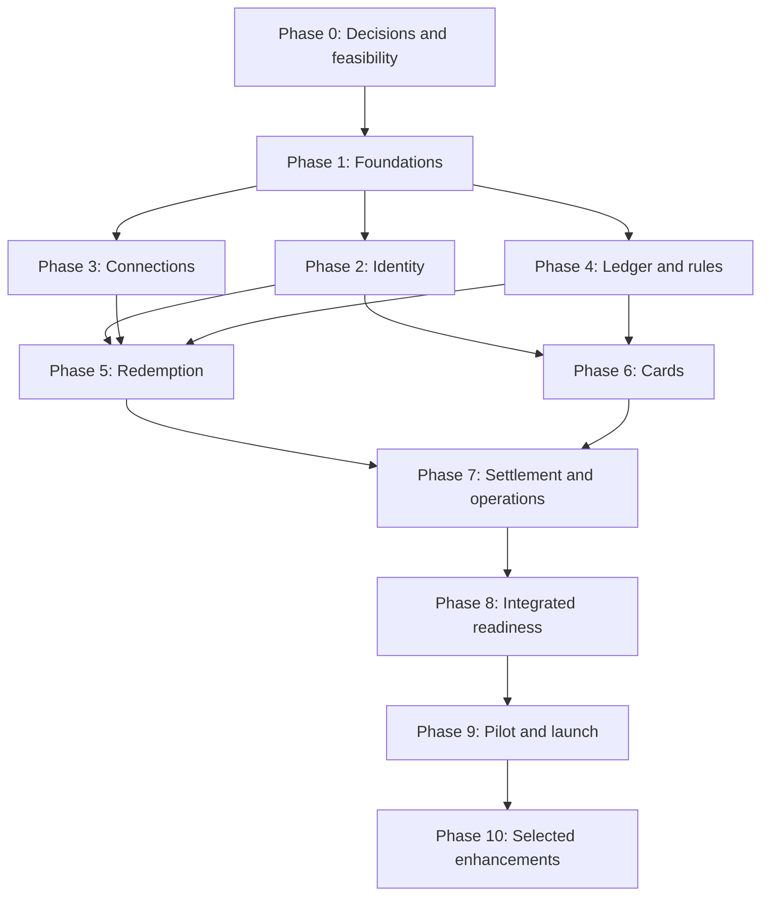

# Pull2Spend - Phased Implementation Plan

| Document control | Value |
| --- | --- |
| Version | 0.9 |
| Date | 27 October 2026 |
| Status | Draft for delivery review; in-house KYC controls approved, required operating values pending |
| Business owner | Bankole, as named in the BRD |
| Baseline | [Functional Design Document](PULL2SPEND_FDD.md), version 0.5 |
| Business source | [Pull2Spend BRD](Pull2Spend_BRD_2.docx), Draft v1.0 |
| Business review copy | [FDD PDF](PULL2SPEND_FDD.pdf) |
| Plan review copy | [Implementation plan PDF](PULL2SPEND_PHASED_IMPLEMENTATION_PLAN.pdf) |
| Classification | Confidential - Personal Project |

## Contents

- [1. Purpose and tracking rules](#1-purpose-and-tracking-rules)
- [2. Roadmap, dependencies and scope](#2-roadmap-dependencies-and-scope)
- [3. Phase 0 - Business decisions and partner feasibility](#3-phase-0---business-decisions-and-partner-feasibility)
- [4. Phase 1 - Solution contracts and operational foundations](#4-phase-1---solution-contracts-and-operational-foundations)
- [5. Phase 2 - Identity, onboarding and financial eligibility](#5-phase-2---identity-onboarding-and-financial-eligibility)
- [6. Phase 3 - Loyalty connections and point aggregation](#6-phase-3---loyalty-connections-and-point-aggregation)
- [7. Phase 4 - Wallet ledger and commercial rules](#7-phase-4---wallet-ledger-and-commercial-rules)
- [8. Phase 5 - Single- and multi-partner redemption](#8-phase-5---single--and-multi-partner-redemption)
- [9. Phase 6 - Virtual cards and spend processing](#9-phase-6---virtual-cards-and-spend-processing)
- [10. Phase 7 - Settlement, reconciliation and operational reporting](#10-phase-7---settlement-reconciliation-and-operational-reporting)
- [11. Phase 8 - Complete experience and release validation](#11-phase-8---complete-experience-and-release-validation)
- [12. Phase 9 - Migration, controlled pilot and launch](#12-phase-9---migration-controlled-pilot-and-launch)
- [13. Phase 10 - Optional capabilities and expansion](#13-phase-10---optional-capabilities-and-expansion)
- [14. Requirement and acceptance coverage](#14-requirement-and-acceptance-coverage)
- [15. Critical decision and dependency register](#15-critical-decision-and-dependency-register)
- [16. Phase completion register](#16-phase-completion-register)
- [17. Task tracking and phase review templates](#17-task-tracking-and-phase-review-templates)

## 1. Purpose and tracking rules

This plan turns the FDD into a sequence of reviewable implementation phases. Every phase has a goal, dependencies, task checklist, deliverables, and measurable acceptance criteria. It covers the change from provider-to-provider point exchange to externally verified point redemption, a monetary wallet, virtual card spend, and auditable partner settlement.

Phase 1 task and acceptance checkboxes record verified repository implementation and tests. Other phases remain unchecked. Phase 1 is complete following Erastus's acceptance, reported directly by the user on 26 October 2026. Checkbox changes are supported by code, independent engineering review and CI evidence, not by this document alone. No deployment or financial-service approval is implied.

Use these rules throughout delivery:

- Mark a task complete only when its implementation or decision artifact exists and the relevant review/check has passed. Task IDs remain stable when tasks are split or reassigned.
- Record the named assignee, status, evidence link, completion date, and blocker in the delivery tool or the tracking template in section 17. Role owners below are proposed responsibilities, not confirmed staffing.
- A phase closes when its deliverables exist, every acceptance criterion is satisfied, and the accountable reviewer records the outcome. Unresolved requirements remain visible with an owner and resolution plan.
- Keep business, integration, and engineering decisions linked to FDD decision IDs (`OD-01`-`OD-17`). Accepted changes update the FDD and this plan together.
- Test changed behavior and important failure/recovery paths. Use meaningful feature, contract, concurrency, and end-to-end checks; documentation-only tasks need document review rather than new application tests.
- Produce evidence for each enabled partner and issuer integration. Simulators support development; they do not establish live partner capability or authorize production funds.

### 1.1 Review feedback and revision history

On 26 October 2026, the user supplied the BRS developer/reviewer's acceptance for the FDD to progress, with the clarification: "The G is not required." The point-owner/Loyalty Partner system supplies both the points quantity and equivalent monetary value; Pull2Spend does not need to know its conversion principles. Pull2Spend is the confirmed product name and FDD OD-01 is resolved. Wafaa remains only a historical name for the legacy application; infrastructure, cloud identifiers, application code and the original BRD attachment are unchanged.

This acceptance to progress does not approve unresolved legal, funding, issuer or commercial decisions, close a phase, complete an implementation task or authorize deployment. The supplied monetary value is the input to existing commercial fee, wallet-credit and Merchant Revenue Share calculations. Percentage, flat-per-redemption, flat-per-point, tiered and combination commercial models, fee-bearer variants, maker-checker and accounting controls remain in scope. No replacement point-conversion formula or new FX behavior is introduced. Currency mismatches cannot be silently converted; any FX policy remains a separate unresolved approval under FDD OD-03.

Each applicable offer/snapshot/transaction retains the supplied points quantity, monetary amount and currency, source/observation time, quote/transaction reference and validity information where supplied. An executable offer requires authoritative confirmation of its terms. Any change in offered value, including an increase after initial approval, requires a fresh confirmed offer, recalculated allocations and renewed explicit consumer approval before commitment. Keep superseded offers and approval evidence. Never infer a value from a point-conversion rate.

| Version | Date | Revision |
| --- | --- | --- |
| 0.1 | 5 October 2026 | Initial phased delivery plan based on FDD v0.1. |
| 0.2 | 26 October 2026 | Confirm Pull2Spend branding, align to FDD v0.2 and record the BRS review feedback. Revise partner-value contracts, snapshots, quotes, commercial inputs, configuration, validation and acceptance without changing task IDs or completion status. |
| 0.3 | 26 October 2026 | Record the user-directed hosting deferral, verify Phase 1 engineering tasks against implementation and CI, and retain accountable phase acceptance as a separate review outcome. |
| 0.4 | 26 October 2026 | Record Erastus as the user-designated Phase 1 security/operations reviewer, the merge into dev and passing post-merge CI. Acceptance remains pending the recorded review outcome. |
| 0.5 | 26 October 2026 | Record Erastus's acceptance as reported by the user and close Phase 1. Retain the hosting deferral, later business/operating gates, task IDs and other phases' status. |
| 0.6 | 26 October 2026 | Record ongoing Phase 2 backend/mobile implementation, its review procedure and the user's confirmation that verification services and policy are not selected. Keep all Phase 2 completion gates open. |
| 0.7 | 26 October 2026 | Record the Phase 2 completion audit, passing identity/native CI and notification regressions. Mark Phase 2 blocked on unselected services, approved policy and remaining device/review evidence; preserve task IDs and unchecked completion gates. |
| 0.8 | 27 October 2026 | Record the user's acceptance of in-house KYC as the operating approach. Require approval of the proposed checks, evidence sources and policy before implementing capture, internal decisions or an in-house adapter. Preserve task IDs and all Phase 2 completion gates. |
| 0.9 | 27 October 2026 | Record the user's approval of IH-01-IH-08. Replace the control-approval blocker with the specific missing methods, sources and operating-policy values. Preserve task IDs, unchecked Phase 2 gates and separate implementation/operational evidence. |

The illustrative partner response is **10,000 points with a supplied monetary value of QAR 350.00.** Under the deducted-fee example, platform share at 12% is QAR 42.00, wallet credit is QAR 308.00, partner incentive at 25% of platform share is QAR 10.50 and platform retained revenue is QAR 31.50. Point-funding settlement obligations remain separate from the incentive; the example does not approve a funding direction or amount. The partner-billed fee variant still credits QAR 350.00 where that agreed model applies.

No delivery dates or effort estimates are committed here. Estimate phases after Phase 0 confirms vendors, partner capabilities, staffing, and scope. Lead times for contracts, issuer certification, mobile-wallet provisioning, and app distribution belong in that schedule.

## 2. Roadmap, dependencies and scope

| Phase | Outcome | Depends on | Accountable review | Release classification |
| --- | --- | --- | --- | --- |
| 0 | Business scope, funding and partner feasibility established | None | Product owner, finance, compliance | Required decisions |
| 1 | Contracts and operational foundations ready | 0 for relevant decisions | Engineering lead, operations | MVP foundation |
| 2 | Verified identity and controlled financial eligibility | 1 | Compliance, product | MVP |
| 3 | Consented partner connections and reliable point visibility | 1; integrate with 2 | Partnerships, engineering | MVP API partners |
| 4 | Monetary ledger and both commercial share rules | 1, approved funding/accounting decisions from 0 | Finance, engineering | MVP |
| 5 | Safe single- and multi-partner redemption | 2, 3, 4 | Product, finance, operations | MVP |
| 6 | Funded virtual card lifecycle and spending | 2, 4; integrate with 5 | Issuer, engineering, product | MVP |
| 7 | Settlement, reconciliation and complete back office | 5, 6 | Finance, operations | MVP |
| 8 | Complete consumer experience and integrated release evidence | 2-7 | Product, QA, compliance | MVP completion |
| 9 | Controlled migration, pilot and production operation | 8, required external readiness | Product owner, operations | Launch |
| 10 | Approved optional capabilities and expansion | 9 plus capability-specific decisions | Product and relevant domain owner | S/C and new scope |

The diagram summarizes the phase dependencies in the table; external agreements and the detailed entry conditions below also apply.

Phases describe completion gates, not an obligation to keep every workstream idle until the prior phase ends. After Phase 1, identity, API connectors, accounting, mobile screens, and issuer sandbox work can overlap when their own contracts and decisions are ready. Phase 5 cannot complete without Phases 2-4; Phase 6 cannot expose spendable funds without validated ledger/funding controls. Phase 9 cannot enable production redemption before settlement and reconciliation are operational.

The MVP includes all BRD **M** requirements, including multi-partner redemption, independently configurable Merchant Revenue Share, maker-checker, and Apple Pay/Google Pay. These are not postponed to Phase 10. BRD **S** capabilities require an explicit release decision; **C** capabilities remain optional. If a required capability is changed or deferred, record a business-approved scope change rather than silently redefining MVP.

## 3. Phase 0 - Business decisions and partner feasibility

### Goal

Establish an implementable business model and confirm the external capabilities needed for safe redemption, funding, card issuance and settlement.

**Entry dependency:** the BRD and FDD are available for review. **Owners:** product owner, partnerships, finance, legal/compliance and engineering.

### Task checklist

- [ ] P00-T01 Apply confirmed Pull2Spend naming (OD-01 resolved on 26 October 2026) and confirm launch market, operating currency and the release scope for every S/C requirement; record the remaining OD-03 and OD-05 decisions. Documentation of branding does not complete this task.
- [ ] P00-T02 Confirm the licensing/program structure, legal issuer, safeguarding responsibilities, cash backing and float/prefunding arrangements; record OD-02.
- [ ] P00-T03 Select the candidate issuer and 2-3 pilot Loyalty Partners. For the approved in-house KYC controls, name the policy owner and confirm required operating values and evidence sources; assign contacts, commercial owners and any external-source access dependencies.
- [ ] P00-T04 Assess each pilot partner's ownership verification, balance read, supply of points quantity and monetary amount/currency, offer references/validity where supplied, authoritative confirmation, reserve/confirm, status query and guaranteed reversal capabilities; record OD-04 and OD-09. Do not require the partner's conversion principles.
- [ ] P00-T05 Confirm issuer balance/hold authority, late capture, fees, refunds, disputes, device-wallet token lifecycle and Apple Pay/Google Pay launch-market eligibility; record OD-11 and OD-12.
- [ ] P00-T06 Define partner fee bearer, funding direction, payout basis, revenue ceiling, approved overrides, tier method, rounding and any separately approved FX policy; record OD-06-OD-08 and OD-03. Use the partner-supplied monetary value for commercial calculations; no point-conversion rule is configured.
- [ ] P00-T07 Agree preliminary KYC/risk limits, review responsibilities, manual financial approval policy and case SLAs; record OD-10 and OD-15.
- [ ] P00-T08 Inventory legacy users, providers, point records, vendor links and API consumers; decide membership policy, consent/KYC migration and API compatibility approach; record OD-13 and OD-17.
- [ ] P00-T09 Assign decision owners for settlement terms, retention/residency, recovery and service targets; establish approval milestones for OD-14 and OD-16 before the affected implementation.
- [ ] P00-T10 Create the delivery backlog, named responsibility matrix, dependency/risk register and an estimated schedule based on confirmed staffing and external lead times.

### Deliverables

- A reviewed scope baseline and decision register linked to all 17 FDD decision IDs, with OD-01 resolved and the remaining decisions explicitly tracked.
- Pilot partner capability assessments, issuer feasibility evidence and an approved funding/commercial model.
- A staffed backlog, dependency register and delivery estimate with explicit external assumptions.

### Acceptance criteria

- [ ] P00-A01 Every open decision has an owner, required evidence, due milestone and status; blockers for funding/accounting/card design are resolved before those work packages start.
- [ ] P00-A02 Each redemption-enabled pilot partner has a documented safe completion/recovery mechanism; unsupported partners are explicitly view-only or excluded from redemption.
- [ ] P00-A03 The worked example starts with 10,000 points with a supplied monetary value of QAR 350.00 and is commercially approved or replaced by a reviewed example. Identify wallet credit 308.00, platform share 42.00 at 12%, partner incentive 10.50 at 25% of platform share, retained revenue 31.50 and actual point-funding obligations separately; BRS acceptance to progress is not commercial or funding approval.
- [ ] P00-A04 The issuer confirms the proposed virtual-only, points-funded model and Day-1 mobile-wallet provisioning path; relevant legal/compliance reviewers record the operating-model outcome.

**Completion evidence:** reviewed decisions, partner/issuer assessments and accountable reviewer outcome. This gate governs subsequent implementation, not creation of this planning document.

## 4. Phase 1 - Solution contracts and operational foundations

### Goal

Provide shared contracts, access controls, event processing and operational evidence so later financial features can be implemented consistently.

**Entry dependencies:** approved Phase 0 decisions relevant to the behavior being enabled. Current work enables no real financial service. **Owners:** engineering, security/compliance and operations.

On 26 October 2026, the user excluded hosting from the current phase because it will be selected elsewhere later. Provider-specific infrastructure, live secrets, deployed alerts and operational activation move to H-01. Local/CI isolation, protected data controls, configuration contracts and resilience design remain in Phase 1.

### Task checklist

- [x] P01-T01 Verify installed application/package versions and assess reusable legacy components; identify changes needed without assuming earlier specifications match deployed behavior.
- [x] P01-T02 Produce the detailed logical/data design for identity, connections, partner value offers, quotes, redemption legs, wallet accounts, events, rules, settlement and cases; retain supplied points/amount/currency, source/time, references and validity where supplied, confirmation evidence and linked consumer approvals; omit partner point-conversion configuration/entities.
- [x] P01-T03 Define and review versioned consumer/internal API contracts, ownership checks, safe error responses and idempotency semantics; decide the new API version explicitly.
- [x] P01-T04 Define connector, issuer, screening and settlement contracts, including supplied quantity/monetary amount/currency, quote/transaction references and validity where supplied, authoritative confirmation of accepted terms, callback verification, operation IDs, status queries and recovery obligations. Specify changed-offer reapproval and currency-mismatch handling without introducing FX.
- [x] P01-T05 Implement the back-office shell with MFA, roles, least-privilege permissions, partner/customer scoping and time-bound privileged elevation.
- [x] P01-T06 Implement append-only audit events, masked operational views and a shared case framework with owners, SLA tracking and resolution evidence.
- [x] P01-T07 Establish durable job/event processing, callback deduplication, bounded retries, recovery scheduling and notification dispatch independent of financial completion.
- [x] P01-T08 Deliver provider-neutral environment and secret/key injection contracts, protected data handling, fail-closed diagnostics and monitoring; validate local/CI isolation and document production resilience/backup design. Hosting selection, hosted development/staging provisioning, managed-store integration and operational activation are deferred to H-01 by the user.
- [x] P01-T09 Establish CI checks, integration simulators, contract fixtures and failure/concurrency validation conventions; record baseline legacy compatibility checks.

### Deliverables

- Reviewed API/data/integration contracts and architecture decisions.
- Working access/audit/case foundations, event infrastructure and isolated local/CI test environments.
- CI baseline, contract fixtures and an operational monitoring plan.

### Acceptance criteria

- [x] P01-A01 Contract examples specify ownership, eligibility, idempotency conflicts, errors and asynchronous outcomes, supplied points/amount/currency, references/validity where supplied and authoritative confirmation. Missing executable values, expired/unconfirmed terms and changed offers block commitment pending valid terms and renewed approval; document external capability assumptions without requiring conversion rules.
- [x] P01-A02 MFA and role/scoping tests deny unauthorized access; audit records contain actor/action/reason without secrets or sensitive payloads.
- [x] P01-A03 Duplicate callbacks, interrupted jobs and failed notifications are handled without duplicate side effects or loss of durable work.
- [x] P01-A04 Relevant existing API behavior has a recorded compatibility baseline; new capabilities can be disabled independently without losing committed event processing.

**Engineering evidence:** [Phase 1 foundations](PULL2SPEND_PHASE1_FOUNDATIONS.md), [merged PR #28](https://github.com/hussain4real/loyaltypoint/pull/28), and [post-merge CI run 40293078614](https://github.com/hussain4real/loyaltypoint/actions/runs/40293078614). Merge commit `d25c9ee08f012e43e41987a52b4124befbd1300a` is in `dev`. All four post-merge checks passed, including the 521-test suite with 1,677 assertions on SQLite and MySQL and a separate MySQL concurrent-worker test. Independent engineering review and the resolved PR findings support the checked items.

**Accountable review:** Erastus is the user-designated Phase 1 security/operations reviewer. On 26 October 2026, the user directly reported his outcome as "accepted" in response to the Phase 1 review-outcome question. This chat response is the acceptance evidence; no separate reviewer attachment or decision date was supplied. Phase 1 is complete for P01-T01 through P01-T09 and P01-A01 through P01-A04. Hosting remains excluded under H-01. Later legal, funding, issuer, commercial and live operating decisions remain subject to their existing gates.

**FDD alignment:** sections 4, 14-16; AC-22; platform portions of AC-09, AC-12 and AC-23.

## 5. Phase 2 - Identity, onboarding and financial eligibility

### Goal

Allow consumers to register, verify identity and obtain controlled eligibility for wallet/card actions, with a usable compliance review process.

**Entry dependency:** Phase 1; approved KYC and risk policy. **Owners:** identity/mobile engineering, compliance and QA.

### Task checklist

- [ ] P02-T01 Implement registration, verified contact activation and purpose-bound, expiring, single-use OTP flows with request/attempt controls.
- [ ] P02-T02 Implement device-bound biometric login, PIN/password fallback, session locking and approved step-up policies.
- [ ] P02-T03 With IH-01-IH-08 approved, after the required FDD section 6.1 method/source and policy values are recorded, implement the BRD's automated ID-document authenticity check, liveness-checked selfie and identity verification through the in-house process. Capture and internal decision interfaces depend on those completed operating values.
- [ ] P02-T04 After the required FDD section 6.1 operating values are recorded, implement sanctions/PEP/adverse-media screening with approved sources, current search evidence and owned, versioned observations. Authenticate and deduplicate external callbacks where sources supply them; deduplicate internal submissions as well.
- [ ] P02-T05 Implement compliance review queues, reason codes, evidence access, approval/rejection and re-verification workflows.
- [ ] P02-T06 Enforce central KYC/account restriction checks for all financial entry points; enable read-only pre-KYC access only if approved as S scope.
- [ ] P02-T07 Emit an idempotent approved-enrollment event for exactly one wallet and automatic card provisioning; complete wallet/issuer integration in Phases 4 and 6.
- [ ] P02-T08 Deliver onboarding/security screens and KYC/security notifications with safe remediation states.
- [ ] P02-T09 Validate duplicate screening callbacks, unresolved screening hits, suspended users, expired OTPs and unauthorized sensitive actions.

### Deliverables

- Working consumer onboarding, login and KYC integration.
- Compliance review/restriction controls and eligibility APIs.
- Automated validation and enrollment-event evidence; documented reviewer procedures.

### Acceptance criteria

- [ ] P02-A01 Invalid, expired or reused OTPs cannot activate an account; login/step-up/session behavior follows approved policy.
- [ ] P02-A02 Screening hits remain under review and cannot unlock financial features; rejection/re-verification provides clear consumer and reviewer actions.
- [ ] P02-A03 Repeated approval callbacks emit one economic enrollment outcome; end-to-end proof of one wallet/card request is required again in Phases 4 and 6.
- [ ] P02-A04 Unverified or restricted users are blocked consistently from every financial operation; sensitive evidence access is role-limited and audited.

**FDD alignment:** FR-1.1-FR-1.9; AC-01-AC-03 and eligibility portions of AC-13/AC-22. New-device/location challenge is implemented here if included in the approved S scope.

### Implementation and review record - 26 October 2026

The backend implementation is in the Laravel repository. The consumer app is the Flutter project `app/` in [Wafaa mobile](https://github.com/Wafaa-app/wafaa). Pull2Spend mode uses Laravel V2 as its identity authority. The previous Firebase flow remains an explicit legacy mode. Existing application and infrastructure identifiers are retained.

| Tasks | Implemented evidence | Remaining completion evidence |
| --- | --- | --- |
| P02-T01, P02-T09 | Encrypted pending registration, purpose-bound hashed contact codes, atomic attempts/consumption, request limits, durable delivery/recovery, verified activation and legacy-credential isolation. Backend tests include real concurrent processes | Approved current notice content/versions, actual permitted delivery configuration and review of the integrated consumer journey |
| P02-T02, P02-T08 | Password fallback, expiring device/session authority, inactivity/background lock, action-bound step-up, device revocation, native P256 signing bridges and Flutter onboarding/security/remediation screens. Android and unsigned iOS compile in CI. Native keys remain on the device; key possession is not hardware attestation | Approved session/step-up policy and physical iOS/Android biometric, cancellation, invalidation and fallback evidence |
| P02-T03, P02-T04 | Trusted verification boundary, strict authenticated local fixture callbacks and owned evidence references. The default adapter and capture/upload path report unavailable. In-house operating approach and IH-01-IH-08 controls approved on 27 October 2026 | Named evidence sources and validated methods, required operating-policy values and actual process evidence. Fixtures do not complete these tasks |
| P02-T05, P02-T06 | Scoped MFA compliance queues, immutable review/receipt evidence, latched screening exceptions, independent restrictions, reverification and central current eligibility checks. Foreign resource lookups are scoped before retrieval | Approved KYC/risk, evidence access/retention and review policies; approved protected evidence access; integration of the guard at later financial commands |
| P02-T07 | One durable initial-enrollment intent across duplicate callbacks, concurrent approvals and reverification. Notifications remain independent. Fixture intents carry their assurance and no financial authority | Completed in-house operating-policy values and actual verified identity evidence. Phase 4/6 consumers must recheck eligibility and prove one wallet/card effect; Phase 2 creates no balance or real issuer request |

On 26 October 2026, the user confirmed that verification providers and the approved policy were **not selected yet**. On 27 October 2026, the user accepted an in-house KYC approach. The user subsequently approved all IH-01-IH-08 controls on the same date. The remaining inputs are the required methods, evidence sources and operating-policy values. A commercial KYC platform is optional. Hosting remains excluded under H-01. All Phase 2 task and acceptance checkboxes stay unchecked until their complete evidence and accountable review exist. Local defaults and fixture results do not approve policy or establish real KYC verification.

The [V2 OpenAPI contract](pull2spend-v2.openapi.yaml), version 0.2.0, distinguishes implemented identity routes, local fixture routes, unavailable provider capture and planned later-phase operations. Backend consumer identity admission is disabled by default. New V2 credentials cannot bypass session controls through V1 or the legacy `/api/user` route. Ordinary legacy credentials retain their existing scope.

Implementation review is tracked in [backend PR 31](https://github.com/hussain4real/loyaltypoint/pull/31), targeting `dev`, and [mobile draft PR 15](https://github.com/Wafaa-app/wafaa/pull/15), targeting the mobile repository's existing `feature/dev` branch. On 26 October 2026, backend revision `cbcdd3f` passed all four CI checks: the MySQL suite passed 673 tests / 2,446 assertions, followed by six concurrent-worker tests / 53 assertions. An initial MySQL migration failure was corrected by shortening four generated constraint names and adding a SQL-compilation regression; it was not treated as a passing run.

The mobile change preserves development baseline `67a699b`, its declared dependencies, native application IDs and legacy composition. All 29 added identity tests pass and their strict analysis is clean. The complete local suite has the same 51 failures as the unchanged baseline (734 baseline passes; 763 with identity), and both full analyzers report the same 434 findings. These existing compatibility failures remain visible in CI and keep the mobile PR in draft.

At mobile revision `151f65d`, identity CI, the Android debug APK build and unsigned iOS build pass. The full Linux compatibility suite reports 763 passes / 50 failures and remains a failing gate. Initial CI setup failures were corrected by committing the resolved Flutter lockfile and selecting Xcode 16.4 for existing Firebase Swift syntax; declared package dependencies were unchanged. Native compilation and physical-device verification are separate evidence: biometric enrollment, cancellation, key invalidation and fallback still require physical iOS/Android checks. None of these results closes Phase 2 or constitutes deployment evidence.

A follow-up at mobile revision `a6d5aac` corrects notification token handling in the retained mobile service: opaque tokens no longer fail on short lengths or appear in diagnostics, refresh listeners belong to the current session, removal follows any in-flight registration, and switching accounts removes the previous registration before new setup even if permission is denied. Ten failing-before regressions now pass. The combined identity/notification suite passes 50 tests; strict analysis of the modified service/tests is clean. The complete local suite passes 774 tests with 50 existing failures, resolving one baseline failure with no new failure labels. CI at this revision passes identity analysis/tests and both native builds; full Linux compatibility remains failing with 774 passes / 49 failures. This is mocked SDK/repository and compilation evidence; it does not establish live push delivery or selected-service readiness.

**Completion audit outcome - 26 October 2026: Blocked.** The working KYC integration deliverable and P02-T03/P02-T04 require selected services and their authenticated protocols; the user confirmed that these services are not selected. Approved notice content/versions, KYC/risk/session/evidence policy, physical biometric verification and accountable Phase 2 acceptance also remain unrecorded. P02-T01-P02-T09 and P02-A01-P02-A04 therefore remain open. The next integration work requires the selected-service documentation/sandbox access references and approved policy/notice baseline, followed by actual capture, evidence access, provider contract journeys, device checks and review. Hosting remains excluded under H-01.

### In-house KYC control approval and remaining values - 27 October 2026

The user accepted in-house KYC as the operating approach and subsequently replied "approved" to the IH-01-IH-08 protocol review. This supersedes the commercial-provider selection assumption in the 26 October audit and resolves the control-approval request in plan version 0.8. All eight controls, including separate examiner and checker roles, are approved requirements. No repeat approval of those controls is needed.

[FDD section 6.1](PULL2SPEND_FDD.md#61-in-house-kyc-controls-and-required-operating-values) records the approved controls and their missing operating values. The reply did not name an automated document-authenticity method, validated liveness method, screening datasets, role holders, verification validity or session limits, evidence region or retention periods, notice versions or accountable policy owner. These values remain required inputs; approval does not select them by implication.

Phase 2 remains blocked on these operating values and the later implementation and acceptance evidence. Before implementing a new capture flow, internal-decision endpoint or selectable in-house adapter, record the required methods, sources, reviewer and retention rules, policy owner and applicable issuer/compliance requirements. The existing unavailable adapter, default-disabled admission and financial eligibility rules remain unchanged. Operational enablement requires actual verification evidence, physical-device validation and accountable Phase 2 acceptance, including applicable issuer/compliance acceptance. Hosting remains deferred under H-01.

The approved two-person positive-approval requirement is not yet implemented by the current review workflow described below. All Phase 2 tasks and acceptance criteria remain unchecked. This revision records approval of the control design; it does not close an implementation task or enable financial features.

Compliance reviewers use this procedure for the implemented workflow:

1. Sign in to the back office with current MFA and open `/backoffice/identity/reviews`. Only the scoped Compliance role has identity review, evidence and restriction permissions.
2. Inspect the current revision, authenticated check summaries and unresolved check names. Evidence references are audited; actual protected evidence viewing requires the approved process and sources. Generic case closure does not approve identity.
3. Submit the expected revision, coded reason, evidence reference and decision. Approval requires all mandatory checks to be complete and every latched screening exception explicitly resolved. Stale review attempts are rejected.
4. Request reverification or impose/clear an account restriction through its separate audited action. A fresh adverse observation after approval forces reverification and creates a new owned incident. Older clear callbacks cannot restore approval.
5. Check the immutable decision/audit evidence and the consumer-safe status/notification. Verify central eligibility separately. Review actions never credit a wallet, issue a card or settle funds.

## 6. Phase 3 - Loyalty connections and point aggregation

### Goal

Give consumers a reliable, consented view of externally held points and provide certified API connector capabilities for redemption.

**Entry dependencies:** Phase 1 contracts; Phase 2 connection step-up/ownership controls. **Owners:** integration engineering, partnerships and mobile engineering.

### Task checklist

- [ ] P03-T01 Implement the partner catalogue, capability flags, environment/go-live status and configuration-driven mappings for supported protocols, including supplied quantity/value/currency and reference/validity mappings; exclude partner point-conversion rules.
- [ ] P03-T02 Implement partner-hosted delegated authorization, verified callbacks, account ownership checks and protected token references.
- [ ] P03-T03 Implement consent grant/view/revoke and connection states, including reauthorization and graceful degradation.
- [ ] P03-T04 Build pilot API adapters for balance/value read, authoritative offers for selected points, confirmation of accepted supplied terms, health, reserve/confirm, release/reverse and authoritative operation-status lookup as supported by each partner.
- [ ] P03-T05 Implement timestamped balance snapshots with partner-supplied points and equivalent monetary value/currency, source/time and reference/validity where supplied; keep zero balances distinct from refresh errors. If no value is supplied, show value unavailable without deriving an estimate.
- [ ] P03-T06 Implement manual single/all refresh and background refresh within partner rate limits; cache read-only offline views.
- [ ] P03-T07 Implement connection/dashboard screens showing supplied values, currency, freshness and validity where supplied, plus back-office connector setup, supplied-value field mappings, health and secrets-reference views; no point-conversion configuration screen.
- [ ] P03-T08 Certify pilot connectors against partner sandbox evidence and capture limitations, failure scenarios and enablement criteria.
- [ ] P03-T09 Verify cross-user access denial, consent revocation, revoked tokens, rate limiting and isolation when one partner is unavailable.

### Deliverables

- Partner connection/catalogue APIs, consent records and consumer balance dashboard.
- Pilot adapters with a documented capability/certification matrix.
- Connector administration, health monitoring and outage procedures.

### Acceptance criteria

- [ ] P03-A01 Consumers can connect, refresh and revoke only their own memberships; revoked consent blocks new partner access and financial initiation.
- [ ] P03-A02 A failed refresh retains the last successful points/value snapshot with its currency, timestamp and error; it cannot masquerade as zero points. A successful refresh displays only a partner-supplied value; a missing value is unavailable rather than calculated.
- [ ] P03-A03 Offline balances are clearly read-only, and unsupported debit/recovery capabilities cannot be enabled for redemption.
- [ ] P03-A04 Each pilot adapter passes its contract checks for supplied terms, references/validity where supplied and authoritative confirmation; missing/expired/unconfirmed values cannot execute and changed values require renewed approval. One connector outage preserves the rest of the consumer experience.

**FDD alignment:** FR-2.1, FR-2.2, FR-2.4-FR-2.7, FR-2.9; AC-04, AC-05 and connector portions of AC-11/AC-24. Vault and batch S scope is handled in Phase 10 unless explicitly moved into this release.

## 7. Phase 4 - Wallet ledger and commercial rules

### Goal

Establish a correct monetary source of truth and auditable platform/partner share calculations before any redemption becomes spendable.

**Entry dependencies:** Phase 1; approved funding, accounting, fee-bearer, rounding and payout decisions. **Owners:** finance, backend engineering and QA.

### Task checklist

- [ ] P04-T01 Implement exactly one wallet per eligible user and agreed operating-currency/minor-unit rules, separate from local point balances.
- [ ] P04-T02 Implement immutable balanced monetary postings, unique business references, linked reversals/adjustments and financial provenance.
- [ ] P04-T03 Implement posted, pending, restricted, held and available balance views with wallet-capacity reservations for concurrent operations.
- [ ] P04-T04 Implement approved safeguarding/funding confirmation controls and account mappings for cash, partner clearing, liabilities, revenue and payouts.
- [ ] P04-T05 Implement effective-dated platform share models using partner-supplied monetary value, quantity or volume as appropriate: percentage, flat per redemption/point, tiers and approved combinations; support deducted and partner-billed fees. Flat per-point commercial charges do not define point valuation.
- [ ] P04-T06 Implement independently configured Merchant Revenue Share, disabled by default, with approved calculation basis and runtime revenue-ceiling checks.
- [ ] P04-T07 Implement maker-checker rule approval, rule overlap validation, accepted version snapshots and separately approved negative-margin overrides.
- [ ] P04-T08 Implement approved caps and tier counters when included in S scope; define concurrent reservation and adjustment treatment for period totals.
- [ ] P04-T09 Implement wallet statements/funding provenance and commercial configuration/reporting foundations, linked to the accepted supplied terms and approval evidence; prohibit edits to historical financial amounts and omit partner conversion-rate settings.
- [ ] P04-T10 Validate supplied-value commercial allocations, decimal rounding, split conservation, concurrent balance changes, fee-bearer variants and the approved financial examples; verify missing values and unsupported currencies cannot silently produce wallet credit.

### Deliverables

- Wallet and double-entry ledger services/APIs with funding and balance controls.
- Platform share and Merchant Revenue Share engines, maker-checker screens and rule history.
- Finance-approved posting examples, accounting invariants and automated evidence.

### Acceptance criteria

- [ ] P04-A01 Duplicate enrollment produces one wallet; local provider points cannot become opening wallet money without authorized confirmation and funding.
- [ ] P04-A02 Every monetary transaction balances within its currency; posted history is immutable and corrections use linked entries.
- [ ] P04-A03 A partner response of 10,000 points with a supplied monetary value of QAR 350.00 produces platform share 42.00 at 12%, wallet credit 308.00, partner incentive 10.50 at 25% of share and retained revenue 31.50; the partner-billed variant credits 350.00 when that model applies. Point-funding obligations are accounted separately; no conversion rate is calculated.
- [ ] P04-A04 Self-approval, overlapping effective rules and unapproved excessive payouts are blocked; concurrent transactions conserve funds/capacity and retain rule versions.

**FDD alignment:** FR-4.1-FR-4.6; FR-6.1-FR-6.13, with FR-6.14 completed in Phase 7; AC-02, AC-06, AC-07, AC-18, AC-19 and ledger portions of AC-09/AC-13.

## 8. Phase 5 - Single- and multi-partner redemption

### Goal

Redeem externally verified points using the partner-supplied monetary value to create confirmed, funded wallet value with no duplicate redemption and a controlled outcome for every partial failure.

**Entry dependencies:** Phases 2-4 and certified redemption-enabled pilot connectors. **Owners:** backend/mobile engineering, finance, operations and QA.

### Task checklist

- [ ] P05-T01 Implement one/multiple partner selection, quantity validation, "all available," partner minimum/maximum and transitions from supplied indicative values to authoritative offers for selected quantities; do not calculate point-to-money values.
- [ ] P05-T02 Implement expiring per-leg quotes recording partner-supplied points quantity, monetary amount/currency, source/time, quote/transaction reference and validity information where supplied, fees, accepted commercial versions, consolidated credit and completion windows; retain the accepted offer evidence without conversion-rate configuration.
- [ ] P05-T03 Implement consumer confirmation and required step-up; authoritatively confirm offered quantity/value/currency and validity, and recheck live balances, consent, KYC, restrictions, risk windows and wallet capacity. Any offered-value change, including after initial approval, requires a fresh confirmed offer, recalculation and renewed explicit consumer approval before commitment.
- [ ] P05-T04 Implement parent/leg state machines, stable operation references and user/operation-scoped idempotency with payload-conflict rejection.
- [ ] P05-T05 Implement point and wallet/risk-capacity reservations, authoritative confirmation of partner debits and accepted supplied terms, and one atomic internal completion posting; stop changed terms for renewed approval and use controlled release/recovery for existing reservations.
- [ ] P05-T06 Implement all-or-nothing multi-partner recovery: query unknown outcomes, reverse confirmed legs, release remaining reservations and retain pending cases until evidence confirms resolution.
- [ ] P05-T07 Implement bounded safe retries, crash/restart recovery jobs, manual retry/reversal/escalation and case ownership/SLA controls.
- [ ] P05-T08 Implement consumer status/history, per-leg progress and completion/failure notifications; add personal exports if included in S scope.
- [ ] P05-T09 Validate races, duplicate requests/callbacks, missing/expired/unconfirmed supplied values, changed offers including increases after approval, renewed consumer approval, revoked connection access, currency mismatches, caps, interrupted posting and insufficient points; no silent FX or fallback valuation.
- [ ] P05-T10 Validate each supported partner combination with injected reserve/confirm/reversal failures; record which outcomes require external resolution.

### Deliverables

- End-to-end quote/confirmation/status/history workflows for single- and multi-partner redemption.
- Durable recovery and financial case workflows with controlled consumer states.
- Partner-specific failure/concurrency evidence and operations recovery procedures.

### Acceptance criteria

- [ ] P05-A01 A completed redemption has authoritatively confirmed partner legs and accepted supplied quantities/values/currencies, linked consumer approval and offer references/validity where supplied, cash backing under the approved model and exactly one wallet/revenue posting; pending credit is never spendable.
- [ ] P05-A02 Expired, missing or unconfirmed offers block commitment; any changed offered value requires authoritative confirmation, a recalculated preview and renewed explicit consumer approval, including after initial approval. Insufficient points, restrictions, risk/wallet-capacity limits and unapproved currency mismatches block commitment without silent FX.
- [ ] P05-A03 One failed leg cannot create partial spendable credit. Unknown/failed reversal outcomes stay under owned recovery, with no false claim that points were restored.
- [ ] P05-A04 Repeated requests, callbacks and crash recovery create one economic result; limits/capacity cannot be exceeded by concurrent requests and unsafe retries are prevented.

**FDD alignment:** FR-3.1-FR-3.9; AC-06-AC-13. FR-3.11 exports are S; FR-3.10 expiry alerts remain C. Batch-specific pending workflows are certified when batch scope is enabled.

## 9. Phase 6 - Virtual cards and spend processing

### Goal

Let eligible consumers spend only confirmed available wallet funds through a secure virtual card, including Apple Pay and Google Pay.

**Entry dependencies:** Phases 2 and 4, issuer contract/certification access; complete integration with Phase 5. **Owners:** issuer integration/mobile engineering, issuer, finance and QA.

### Task checklist

- [ ] P06-T01 Integrate enrollment-triggered automatic issuance using stable request references and no duplicate active cards.
- [ ] P06-T02 Implement accurate pending/confirmed lifecycle states for issuance, freeze/unfreeze, close/reissue and failure recovery cases.
- [ ] P06-T03 Implement issuer-hosted tokenized details reveal with step-up; verify PAN/CVV and sensitive card data are absent from Pull2Spend persistence/logs.
- [ ] P06-T04 Integrate and certify Apple Pay/Google Pay provisioning and the handling of existing device-wallet tokens after freeze, closure and reissue.
- [ ] P06-T05 Implement issuer/platform funding and balance authority so available card spend matches the wallet after holds/restrictions.
- [ ] P06-T06 Implement authorization, decline, partial/full capture, hold release/expiry, refund and chargeback events with deduplication and financial references.
- [ ] P06-T07 Implement issuer-required EMV/3-D Secure flows and agreed late/excess capture, foreign-fee and dispute handling without an uncontrolled overdraft.
- [ ] P06-T08 Implement card/activity screens, approved/declined transaction notifications and enabled MCC/geographic controls if included in S scope.
- [ ] P06-T09 Validate issuance/lifecycle retries, reordered events, holds through reissue/closure, refunds and issuer outage/recovery.

### Deliverables

- Issuer integration, virtual card lifecycle and consumer card/activity screens.
- Certified device-wallet provisioning and funded authorization/capture/refund processing.
- Issuer contract test results, financial event evidence and card recovery procedures.

### Acceptance criteria

- [ ] P06-A01 Approved enrollment automatically creates one wallet/card issuance request across repeated callbacks; unknown issuer outcomes remain accurately pending and owned.
- [ ] P06-A02 With 308.00 available, a 100.00 authorization reduces availability to 208.00; capture posts one debit and releases the corresponding hold without a second deduction.
- [ ] P06-A03 Partial/reordered/duplicate events preserve correct holds and financial entries; frozen/restricted/insufficient-funds authorizations are denied as applicable.
- [ ] P06-A04 Both Apple Pay and Google Pay pass the issuer-approved applicable device/market certification cases; reveal requires step-up and no PAN/CVV is stored in Pull2Spend.

**FDD alignment:** FR-5.1-FR-5.9; AC-02, AC-14-AC-17 and issuer portions of AC-21/AC-24. Actual certification depends on external issuer/scheme readiness.

## 10. Phase 7 - Settlement, reconciliation and operational reporting

### Goal

Make every financial obligation verifiable and operable, with settlement controls, daily card reconciliation, complete back-office cases and reports.

**Entry dependencies:** Phases 5 and 6; approved partner schedules, cutoff, schemas, netting, payment direction and retention. **Owners:** finance, operations and backend engineering.

### Task checklist

- [ ] P07-T01 Implement per-partner schedule/timezone/cutoff, immutable transaction membership and separately recorded payable/receivable funding obligations.
- [ ] P07-T02 Generate versioned/checksummed settlement files containing supplied points quantity, monetary value/currency, partner quote/transaction references and validity evidence where supplied, platform share, wallet credit, adjustments and separately itemized Merchant Revenue Share; keep point-funding obligations distinct from incentive payout.
- [ ] P07-T03 Implement verification reports that reconcile file counts/totals to ledger entries and block finalization on a mismatch.
- [ ] P07-T04 Implement secure partner delivery/acknowledgements and funding/payment evidence; separate delivered from economically settled.
- [ ] P07-T05 Implement reruns, late adjustments and overlap protection; add ad-hoc runs if included in S scope.
- [ ] P07-T06 Ingest issuer/processor feeds at least daily and reconcile card events, holds, wallet postings and clearing balances using approved timing tolerances.
- [ ] P07-T07 Complete unified exceptions/case queues, assignment/aging, approved retry/reversal/escalation and evidence-based closure for financial/support cases.
- [ ] P07-T08 Complete customer suspension/reinstatement/offboarding, re-verification, sensitive-view controls, configuration history and audit exports.
- [ ] P07-T09 Deliver operational, financial and risk dashboards plus authorized CSV/PDF/Excel exports and configurable scheduled reports.
- [ ] P07-T10 Implement report/file retention and retrieval; validate duplicate membership, mismatches, delivery failures, payment evidence and correction history.

### Deliverables

- Partner settlement files, verification reports, delivery/payment records and schedules.
- Daily card reconciliation with owned exception cases and auditable resolution.
- Complete back-office/reporting functions, financial close and case procedures.

### Acceptance criteria

- [ ] P07-A01 Files reconcile to their immutable ledger membership and accepted supplied-value evidence before finalization; point-funding obligations and partner incentive are separately verifiable and gross/net directions are explicit.
- [ ] P07-A02 Reruns/overlapping periods cannot settle a transaction twice; delivery success cannot be presented as payment completion.
- [ ] P07-A03 Every unexplained reconciliation break becomes an owned, aged case; closure requires external evidence or approved linked adjustment.
- [ ] P07-A04 Finance can close a representative complete cycle without unexplained point/money discrepancies; authorized reports are retained/exportable and unauthorized access is denied.

**FDD alignment:** FR-6.5, FR-6.13, FR-6.14; FR-7.1-FR-7.9; BRD 7.8.1-7.8.7; AC-19-AC-22. Partner self-service FR-7.10 remains C.

## 11. Phase 8 - Complete experience and release validation

### Goal

Prove that the MVP works as one accessible, secure consumer and operating experience across its normal, failure and recovery journeys.

**Entry dependency:** Phases 2-7 complete enough for integrated validation. **Owners:** product, mobile engineering, QA, compliance/security and operations.

### Task checklist

- [ ] P08-T01 Complete iOS/Android screens and feature parity for onboarding, aggregation, redemption, wallet, card, history, profile and consent.
- [ ] P08-T02 Complete English/Arabic and RTL, screen readers, scaling/contrast, empty/error/offline states and supported current/prior-two-major-OS coverage.
- [ ] P08-T03 Complete help/FAQs, in-app support and dispute initiation with visible case tracking and issuer routing.
- [ ] P08-T04 Complete KYC, redemption, card, low/zero-balance and security notifications; verify preferences and failure-isolated delivery.
- [ ] P08-T05 Execute all applicable FDD AC-01-AC-24, including partner-specific supplied-value contracts, missing/expired/unconfirmed offers, changed values requiring renewed approval, unsupported currency handling, concurrent funding/limit and multi-partner failure scenarios; verify no platform point-conversion calculation or silent FX.
- [ ] P08-T06 Measure dashboard/redemption latency, availability instrumentation, refresh rate limits, scheduled-job windows and usability targets.
- [ ] P08-T07 Validate managed secrets, encryption, callback replay/signatures, mobile integrity/pinning, least privilege, data retention and actual PCI/issuer responsibilities.
- [ ] P08-T08 Complete independent penetration testing required by the BRD; resolve release-blocking findings and document incident response/reporting responsibilities.
- [ ] P08-T09 Drill backups/failover/recovery and verify replay/reconciliation of financial obligations against approved RTO/RPO.
- [ ] P08-T10 Produce the integrated UAT report, open-defect disposition, production-readiness checklist and business/compliance/finance review record.

### Deliverables

- Complete tested mobile apps and support/notification experience.
- UAT, accessibility/device, performance, security and recovery evidence.
- A release candidate with an explicit scope/defect record and readiness outcome.

### Acceptance criteria

- [ ] P08-A01 All MVP M requirements have an implemented path and passing evidence; enabled S requirements are tested and excluded S/C items are explicitly recorded.
- [ ] P08-A02 Applicable AC-01-AC-24 pass; there are no unresolved defects that compromise money correctness, required functionality or approved release-blocking security controls.
- [ ] P08-A03 Measured results meet approved targets, including cached p95 < 3 seconds, live refresh p95 < 8 seconds subject to documented partner conditions, and real-time redemption p95 < 60 seconds.
- [ ] P08-A04 Accessible Arabic/English parity, issuer/device-wallet readiness, ownership restrictions and recovery drills are evidenced; responsible reviewers record release readiness.

**FDD alignment:** sections 13 and 16-18; all applicable acceptance scenarios. The BRD's 99.9% availability target and recovery targets require production measurement/readiness evidence; a short UAT run cannot prove sustained uptime.

## 12. Phase 9 - Migration, controlled pilot and launch

### Goal

Move verified consumers and approved partners into production while preserving old records and maintaining control of all committed financial obligations.

**Entry dependencies:** Phase 8 readiness; required legal/issuer/partner operating agreements, production access and business release authorization. **Owners:** product owner, engineering, operations, finance and compliance.

### Task checklist

- [ ] P09-T01 Rehearse legacy mapping/cutover with preserved histories, ownership evidence, new consent and KYC; verify API compatibility/deprecation communications.
- [ ] P09-T02 Verify opening wallet/clearing/funding positions and cutoff; prevent legacy local points from being automatically duplicated as wallet credit.
- [ ] P09-T03 Complete H-01 hosting readiness before any hosted external integration or pilot. Provision and verify isolated hosted environments, managed secrets/keys, production configuration, partner enablement, funding controls, settlement channels, issuer feeds and alert routing after a hosting target is selected.
- [ ] P09-T04 Prepare app distribution/mobile-wallet certification evidence and business/customer support communications for the approved pilot.

- [ ] P09-T05 Train operations, support, compliance and finance; exercise escalation, dispute, failed redemption, settlement close and incident procedures.
- [ ] P09-T06 Run the formal release readiness review and record the authorized pilot cohort, partner set, limits, monitoring window and stop/expansion criteria.
- [ ] P09-T07 Deploy/enable only after recorded release authorization; run controlled real partner redemption, wallet/card spend and a complete settlement/reconciliation cycle.
- [ ] P09-T08 Monitor KYC/redemption success, p50/p95 times, funded card activation/spend, platform share/payout/net revenue, breaks, fraud and support SLAs.
- [ ] P09-T09 Rehearse/verify a pause procedure that disables new redemption/issuance while retaining card events, recovery, existing liabilities, settlement and reconciliation.
- [ ] P09-T10 Close pilot findings and review evidence against expansion criteria; record broader rollout authorization and ongoing operational ownership.

### Deliverables

- Rehearsed migration/cutover records, verified opening positions and compatibility plan.
- Production/pilot runbooks, trained owners and an authorized release record.
- Pilot financial-close evidence, KPI report and a recorded stop/continue/expand decision.

### Acceptance criteria

- [ ] P09-A01 Opening balances and funding are reconciled; preserved legacy records can be traced and no automatic/unfunded point-to-cash migration occurs.
- [ ] P09-A02 The approved cohort completes real redemption, funded spend, settlement and reconciliation with no unexplained discrepancies at close.
- [ ] P09-A03 Partner failures, aged cases and issuer/settlement interruptions trigger the approved alerts/escalations; every live service and financial process has an accountable owner.
- [ ] P09-A04 Pilot thresholds and pause/expansion criteria defined before activation are met; the recorded decision authorizes the next rollout step.

**FDD alignment:** section 20; AC-09-AC-24 in production-approved scenarios. Production dates, cohort sizes and business thresholds remain Phase 0/9 decisions rather than assumed commitments.

## 13. Phase 10 - Optional capabilities and expansion

### Goal

Add approved capabilities after the MVP is stable, using evidence from the pilot and fresh decisions for each extension.

**Entry dependencies:** Phase 9; an approved scope/business case and prerequisites for each selected extension. **Owners:** product and the relevant finance, risk, partner or engineering owner.

### Task checklist

- [ ] P10-T01 Prioritize outstanding S/C items using pilot evidence; define each extension's scope, owner, dependencies, deliverables and acceptance cases before implementation.
- [ ] P10-T02 If selected, add read-only pre-KYC tiers and new-device/location challenge policies not already delivered; preserve central eligibility controls.
- [ ] P10-T03 If selected, add batch/file connectors with validated file integrity, ownership, supplied quantity/value/currency and reference/validity evidence where supplied, authoritative confirmation of accepted terms, pending windows and safe recovery/settlement handling; changed values require renewed consumer approval.
- [ ] P10-T04 If selected, add explicitly consented credential-vault balance retrieval with approved per-user encryption and managed keys; permit redemption only through a separately certified debit interface.
- [ ] P10-T05 If selected, add personal statement exports, commercial fee/payout caps, MCC/geographic controls and ad-hoc settlement not already included in the release.
- [ ] P10-T06 If selected, add opt-in point-expiry alerts using authoritative partner expiry data and read-only partner self-service with strict partner scoping.
- [ ] P10-T07 If selected, improve connector onboarding and operational analytics using measured onboarding time, incident trends and support demand.
- [ ] P10-T08 Treat new currencies/markets, physical cards, peer transfers, white-labeling or a marketplace as separate scope changes with legal, issuer, funding and accounting review.
- [ ] P10-T09 Certify, migrate and release each selected extension separately; update the FDD, APIs, operating procedures and acceptance evidence.

### Deliverables

- An approved enhancement backlog and capability-specific designs.
- Implemented/certified selected extensions with updated contracts and operational procedures.
- Measured adoption/operating results and a release outcome for each extension.

### Acceptance criteria

- [ ] P10-A01 Each released extension has its own goal, tasks, deliverables, measurable acceptance and recorded scope approval; unselected items stay unchecked.
- [ ] P10-A02 Batch/vault connections do not weaken ownership, freshness, consent or redemption recovery guarantees; incomplete confirmation remains pending rather than spendable.
- [ ] P10-A03 New caps/exports/controls/portals preserve financial integrity, audit and data scoping; existing MVP regression scenarios remain satisfied.
- [ ] P10-A04 New regulated/commercial scope is enabled only after its own funding, issuer and operating responsibilities are confirmed.

**FDD alignment:** FR-1.4, FR-1.9, FR-2.3, FR-2.8, FR-3.10, FR-3.11, FR-5.6, FR-6.2, FR-6.9, FR-7.4 and FR-7.10, where not already selected for MVP. Phase 10 is a menu of separately approved releases, not one mandatory package.

## 14. Requirement and acceptance coverage

| Requirement area | Primary phases | Required acceptance evidence |
| --- | --- | --- |
| Onboarding, authentication, KYC and restrictions | 1, 2, 6, 8 | AC-01-AC-03, AC-13; integrated one-wallet/card proof |
| Consent, connectors, aggregation and degradation | 2, 3, 5, 8 | AC-04, AC-05, AC-11, AC-24 |
| Platform share, Merchant Revenue Share and immutable accounting | 4, 5, 7 | AC-06, AC-07, AC-18, AC-19, AC-20 |
| Partner-supplied offers, renewed approval, idempotency, atomic recovery and limits | 4, 5, 8 | AC-08-AC-13 |
| Card issuance/lifecycle, funds, events and reveal | 6, 7, 8 | AC-14-AC-17, AC-21; mobile-wallet/issuer certification |
| Partner settlement and card reconciliation | 7, 9 | AC-20, AC-21; funding/payment evidence and complete close |
| Back-office roles, audit, cases and scoped reports | 1, 2-7, 8 | AC-22 plus case/rule/reconciliation evidence |
| Notifications, support and disputes | 1, 2, 5, 6, 8 | AC-23 and all required channel/event scenarios |
| Accessibility, performance, resilience and recovery | 1, 3, 8, 9 | AC-24; sustained monitoring, security and recovery evidence |
| Legacy transition and live readiness | 0, 9 | Opening-balance, consent/KYC, compatibility and pilot-close evidence |
| Optional capabilities | Selected delivery phase or 10 | Extension-specific cases plus affected MVP regression coverage |

This mapping assigns every FDD acceptance scenario to delivery evidence; it does not replace the requirement-level test matrix. QA must track partner variants, fee-bearer models, payout bases, role scopes and failure/recovery paths separately.

## 15. Critical decision and dependency register

| Dependency | Latest required milestone | Owner | Effect if unresolved |
| --- | --- | --- | --- |
| Legal issuer/licensing, safeguarding and funded wallet model | Before Phase 4 financial implementation and Phase 6 issuer design | Owner, legal/compliance, finance, issuer | Block the affected regulated/funding work |
| Supplied-value confirmation, safe reserve, confirm and reversal operations, and ownership proof | Before adapter certification and Phase 5 integration | Partnerships, engineering | Partner remains view-only or redemption disabled |
| Platform fee bearer, supplied-value commercial basis, payout basis, tiers, rounding and separately approved FX policy | Before Phase 4 commercial implementation | Finance, owner | Calculation/ledger model cannot be accepted |
| In-house KYC protocol/sources, risk limits, wallet caps and step-up thresholds | IH-01-IH-08 controls approved; required methods, sources, role holders and operating-policy values before Phase 2 capture/internal-decision implementation and Phase 2/5 eligibility acceptance | Compliance, product, issuer | Capture/decision implementation and financial eligibility/limit acceptance remain blocked |
| Issuer balance authority, exceptional captures and mobile wallets | Before Phase 6 certification | Issuer, finance, engineering | Card MVP/Day-1 provisioning cannot close |
| Partner funding direction, netting, files and payment evidence | Before Phase 7 financial close | Finance, partnerships | Settlement cannot be finalized as a reliable process |
| Retention/residency, RTO/RPO and case/service SLAs | Before relevant controls and Phase 8 readiness | Compliance, operations, engineering | Release evidence remains incomplete |
| Legacy ownership, new consent/KYC and compatibility | Before Phase 9 cutover | Product, engineering, partnerships | Affected users/APIs remain outside cutover |
| Certification, production agreements and release authorization | Before Phase 9 live activation | Owner, issuer, compliance, operations | Pilot activation remains blocked |

Mock integrations and UI work may continue where they do not depend on the missing decision. They must retain the blocker and cannot be presented as evidence of financial or external readiness.

### Deferred hosting-readiness gate H-01

The user deferred hosting on 26 October 2026. H-01 covers hosting selection, isolated hosted development/staging and production resources, managed secrets and keys, protected storage, worker supervision, deployed monitoring/alert delivery and backup/restore evidence. The owner and destination will be assigned when hosting is selected. H-01 is required before hosted partner/issuer integration or a production pilot. It is not a current Phase 1 blocker and does not approve any existing cloud project. P09-T03 carries the delivery link. All relevant legal, funding, issuer, commercial and operational approvals remain required before the affected live capability.

## 16. Phase completion register

| Phase | Status | Completion/review evidence | Review date |
| --- | --- | --- | --- |
| 0 - Decisions and feasibility | Planned | Pending | Pending |
| 1 - Foundations | Complete | Merged into dev with passing post-merge CI. See [foundations evidence](PULL2SPEND_PHASE1_FOUNDATIONS.md). Erastus: accepted, as directly reported by the user. Hosting deferred to H-01 | 26 October 2026 (user report date) |
| 2 - Identity | Blocked | In-house approach and IH-01-IH-08 controls approved on 27 October 2026. Required methods, sources, operating-policy values and named owner remain pending before capture/internal-decision implementation. Physical-device and accountable acceptance evidence remain open. Identity/native CI passes; legacy compatibility remains failing | Pending |
| 3 - Connections | Planned | Pending | Pending |
| 4 - Ledger and rules | Planned | Pending | Pending |
| 5 - Redemption | Planned | Pending | Pending |
| 6 - Cards | Planned | Pending | Pending |
| 7 - Settlement and operations | Planned | Pending | Pending |
| 8 - Integrated readiness | Planned | Pending | Pending |
| 9 - Pilot and launch | Planned | Pending | Pending |
| 10 - Selected enhancements | Unscheduled | Capability-specific review pending | Pending |

Use `Planned`, `In progress`, `Blocked`, `In review` and `Complete` for Phases 0-9. A selected Phase 10 extension has its own status. A completed checkbox without evidence does not close a phase.

## 17. Task tracking and phase review templates

Copy the following fields into the delivery tracker when assigning a task; keep the canonical task ID from this document.

| Task ID | Named owner | Status | Dependencies/blocker | Implementation or decision evidence | Validation evidence | Completion date |
| --- | --- | --- | --- | --- | --- | --- |
| Pxx-Txx | To assign | Planned | To record | Pending | Pending | Pending |

Record phase review using these fields:

| Review field | Required record |
| --- | --- |
| Phase and baseline | Phase number, plan/FDD version and reviewed scope |
| Deliverables | Links to the completed artifacts and deployed/tested environment where applicable |
| Acceptance | Criterion IDs, result and evidence; applicable FDD AC IDs |
| Remaining items | Defects, blockers, unselected optional tasks and approved scope changes with owners |
| Decision | Complete, blocked or return for correction; reviewer names and date |
| Next phase | Entry dependencies satisfied, responsible owner and remaining external milestones |

Review scope changes with product, finance, compliance or issuer/partner owners as affected. Keep business decisions distinct from technical verification and production authorization. This plan remains the task baseline until its version is updated.

The original v0.1 plan was recovered from the available source record and user-supplied text. At recovery, its phase structure, task and acceptance IDs, dependency gates and completion statuses were preserved. Recovering the document did not implement or deploy application features. Later engineering evidence and phase outcomes are recorded above.
